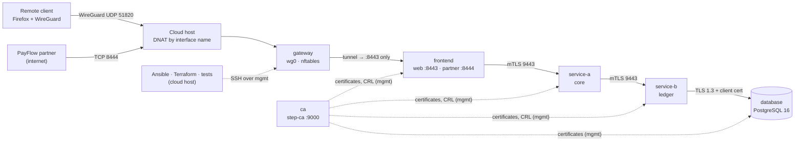

<div align="center">

# ZT Bank — zerotrust-cloud

### Zero-trust mini-cloud for a demo bank, on one laptop

**Default-deny networks · mutual TLS on every hop · short-lived SPIFFE identities · fail-closed revocation · attacked and audited**

[](docs/deployment.md)
[](docs/cloud-host.md)
[](terraform/)
[](ansible/)
[](tools/gen_rules.py)
[](docs/gateway.md)
[](docs/security.md)
[](docs/ca.md)
[](docs/database.md)
[](docs/testing.md)

[Highlights](#highlights) · [Architecture](#architecture-at-a-glance) · [Quick start](#quick-start) · [Docs](#documentation) · [License](#license)

</div>

## Highlights

- **Default deny, verified**: a live probe of every source × destination × port declared in the
  policy (194 probes) found the 21 declared flows reachable and 0 deviations —
  [docs/evidence/drift-summary.md](docs/evidence/drift-summary.md).
- **Identity on every hop**: in a 24-hour audit every request is attributed to the SPIFFE identity of
  a client certificate (376 requests by `customer/alice`, 252 frontend → service-a, 228 service-a →
  service-b) and every refusal is logged with its reason — [docs/evidence/audit.md](docs/evidence/audit.md).
- **Revocation that fails closed**: a revoked copy of a client certificate must be refused on all three
  mTLS services within a 90-second deadline, without restart, and a missing or stale list refuses
  everyone — [tests/attacks/test_attacks.py](tests/attacks/test_attacks.py); 13 requests from the
  remote client with a revoked certificate were refused — [docs/evidence/audit.md](docs/evidence/audit.md).
- **Attacked from a second machine**: 6 of 6 remote checks DEFENDED, including a 65 535-port scan
  (8 s) where only the partner port presents the bank's certificate, and lateral movement with every
  bank network routed into the tunnel — [docs/evidence/remote-client-report.json](docs/evidence/remote-client-report.json).
- **One policy, generated configuration**: firewall rules, mTLS allow-lists, routes, PostgreSQL access
  and the CA issuance policy are generated from [policy.yaml](policy.yaml) by
  [tools/gen_rules.py](tools/gen_rules.py), and the live system is compared with a fresh generation —
  [tests/final/test_drift.py](tests/final/test_drift.py).

## Architecture at a glance



Solid arrows: the data path (the only business flows the firewalls allow). Dotted arrows: the control
path on the isolated mgmt network. Details: [docs/architecture.md](docs/architecture.md).

| Layer | Implementation | Responsibility |
|---|---|---|
| Policy | [`policy.yaml`](policy.yaml), [`tools/gen_rules.py`](tools/gen_rules.py) | single source of truth; validation; generation of every configuration |
| Virtual infrastructure | [`terraform/`](terraform/) | 5 libvirt networks, 6 VMs, static addressing (cloud-init) |
| Host and VM configuration | [`ansible/`](ansible/) | host DNAT, CA, firewalls, WireGuard, certificates, services, revocation |
| Network | [`ansible/roles/nftables/`](ansible/roles/nftables/), [`ansible/roles/wireguard/`](ansible/roles/wireguard/) | default-drop on every VM; tunnel to the website only |
| Identity | [`ansible/roles/ca/`](ansible/roles/ca/), [`ansible/roles/pki-client/`](ansible/roles/pki-client/), [`ansible/certs.yml`](ansible/certs.yml), [`ansible/revoke.yml`](ansible/revoke.yml) | 24 h SPIFFE certificates, renewal, revocation |
| Services | [`ansible/roles/app/files/`](ansible/roles/app/files/) | `zt-mtls` server/client, bank application, website, `zt-crl` |
| Data | [`ansible/roles/postgres/`](ansible/roles/postgres/) | schema, row-level security, append-only ledger, money-moving functions |
| Verification | [`tests/`](tests/), [`remote-client/`](remote-client/), [`tools/zt-attack.py`](tools/zt-attack.py), [`tools/zt-audit.py`](tools/zt-audit.py) | offline and live tests, attack catalogue, audit |

## Quick start

Prerequisites: Linux with `git`, `make`, Python 3 and `python3-venv` (no VM, no cloud account, no root needed for this mode).

```bash
git clone https://github.com/Yassminefeki/PQC-Cloud-Lab.git zerotrust-cloud
cd zerotrust-cloud
make check      # creates .venv, copies env.example.yaml to env.yaml, validates the policy
make gen        # renders build/: nftables, mTLS configs, WireGuard templates, Terraform vars, test matrix
make test-0     # offline test suite (more tests run when PostgreSQL, Chromium or NSS tools are present)
```

Verify:

```bash
.venv/bin/python tools/gen_rules.py --check
```

Expected output:

```
policy OK
```

Full build on a cloud host (six VMs) and connection of a remote client: [docs/deployment.md](docs/deployment.md).

## Known limitations and design scope

| Area | Observation | Mitigation / status |
|---|---|---|
| Frontend trust | the frontend states which customer is calling; root on the frontend can act as any customer within the customer routes and limits ([docs/THREAT-MODEL.md](docs/THREAT-MODEL.md), attack A2 in [tests/attacks/catalogue.yaml](tests/attacks/catalogue.yaml)) | cannot reach the ledger or the database; proposed: end-to-end signed requests; status: open |
| Cloud host exposure | the remote scan found 17 open TCP ports on the cloud host besides the partner port, none presenting the bank's certificate ([docs/evidence/remote-client-report.json](docs/evidence/remote-client-report.json), check B1) | the laptop's own services, outside the bank's policy; mitigation: bind them to 127.0.0.1 or add a host firewall; status: open |
| Revocation latency | enforced within the 90 s test deadline ([tests/attacks/test_attacks.py](tests/attacks/test_attacks.py)); the fetch timer runs every 60 s | `make revoke` refreshes every service at once; exact latency TODO[measure]: `pytest -s tests/attacks -k revoked_within` |
| Database and CRL | PostgreSQL does not consult the CRL ([docs/THREAT-MODEL.md](docs/THREAT-MODEL.md)) | its only client is pinned by address and identity; revoke and re-enrol service-b instead |
| Availability | one instance of every role ([docs/high-availability.md](docs/high-availability.md)) | fail-closed by design; status: accepted for the lab |
| Cryptography | X25519 / P-256, not post-quantum ([docs/THREAT-MODEL.md](docs/THREAT-MODEL.md)) | WireGuard PSK adds a symmetric layer; hybrid ML-KEM key exchange is future work |
| Attack catalogue evidence | the full A1–A11 report is not yet versioned | TODO[measure]: `make attacks && make evidence` writes it to `docs/evidence/attacks.md` |
| Performance | not measured | TODO[measure]: request latency and transfers per second, see [docs/frontend.md](docs/frontend.md) and [docs/service-b.md](docs/service-b.md) |

**Scope decision.** The system runs one virtual machine per role on a single laptop, with services
written against the Python standard library. This was chosen because the hardware is one personal
computer and because short, dependency-free security code is easier to audit and to test end to end.
When a component fails, its flow fails closed: the peers refuse it (502 or 503), nothing falls back to
a weaker check, and every make target is idempotent, so recovery is a restart or a re-run of the stage
([docs/high-availability.md](docs/high-availability.md)). Revisit this choice when the system has to
survive the loss of a machine, serve a measured load, or run on more than one host.

## Repository guide

| Path | Contents |
|---|---|
| [`policy.yaml`](policy.yaml) | the policy: networks, nodes, services, flows, PKI, WireGuard peers, actors, roles, routes, bank limits |
| [`env.example.yaml`](env.example.yaml) | template of `env.yaml` (machine-specific values; `env.yaml` itself is not versioned) |
| [`Makefile`](Makefile) | one target per stage, per test stage, and for revocation, attacks, audit, evidence, demo, live views |
| [`requirements.txt`](requirements.txt) | Python packages for the virtual environment |
| [`pytest.ini`](pytest.ini) | pytest configuration and markers |
| [`.gitignore`](.gitignore) | keeps `env.yaml`, `build/`, `ansible/.secrets/` and every key out of Git |
| [`tools/`](tools/) | generator, statements bot, PayFlow client, attack runner, audit, evidence collector, demo scripts, live infrastructure views |
| [`terraform/`](terraform/) | libvirt networks and virtual machines |
| [`ansible/`](ansible/) | playbooks and roles: host, ca, nftables, wireguard, pki-client, app, postgres |
| [`tests/`](tests/) | offline tests (`tests/unit/`), live tests per stage, attack catalogue and live attacks (`tests/attacks/`) |
| [`remote-client/`](remote-client/) | attack suite B1–B6 and narrated demo for the second machine |
| [`docs/`](docs/) | documentation, threat model, evidence, report, demo video, screenshots |

Generated at run time and never committed: `build/` (configurations, exports, reports), `.venv/`,
`env.yaml`, `ansible/.secrets/`.

## Documentation

| Document | Describes |
|---|---|
| [docs/architecture.md](docs/architecture.md) | components, data and control paths, networks, trust boundaries, identities, design decisions |
| [docs/deployment.md](docs/deployment.md) | full build on a cloud host, remote client setup, day-2 operations |
| [docs/cloud-host.md](docs/cloud-host.md) | the hypervisor laptop: DNAT by interface name, libvirt hook, apt cache, mDNS |
| [docs/gateway.md](docs/gateway.md) | WireGuard termination and the only router |
| [docs/frontend.md](docs/frontend.md) | website, API and partner API; edge checks |
| [docs/service-a.md](docs/service-a.md) | core business rules |
| [docs/service-b.md](docs/service-b.md) | ledger, the only database client |
| [docs/database.md](docs/database.md) | PostgreSQL schema, row-level security, append-only ledger |
| [docs/ca.md](docs/ca.md) | step-ca, issuance policy, enrolment and renewal |
| [docs/revocation.md](docs/revocation.md) | `zt-crl` and fail-closed revocation |
| [docs/statements-bot.md](docs/statements-bot.md) | the machine actor with a device-bound 1-hour certificate |
| [docs/payflow-partner.md](docs/payflow-partner.md) | the signed partner webhook |
| [docs/security.md](docs/security.md) | controls per layer and where each is proven; secrets inventory |
| [docs/testing.md](docs/testing.md) | offline and live tests, stage-to-test map, results |
| [docs/high-availability.md](docs/high-availability.md) | single-instance design, fail-closed behaviour, what HA would need |
| [docs/THREAT-MODEL.md](docs/THREAT-MODEL.md) | assets, attackers, attack catalogue, residual risks |
| [docs/STAGES.md](docs/STAGES.md) | stage-by-stage reference (stages 0 to 13) |
| [docs/evidence/audit.md](docs/evidence/audit.md) | 24-hour security audit report (anonymised) |
| [docs/evidence/drift-summary.md](docs/evidence/drift-summary.md), [docs/evidence/drift-report.json](docs/evidence/drift-report.json) | live N×N matrix probe |
| [docs/evidence/remote-client-report.json](docs/evidence/remote-client-report.json) | remote client attack checks B1–B6 |
| [docs/evidence/unit-tests.txt](docs/evidence/unit-tests.txt) | offline test run |
| [docs/README.md](docs/README.md) | index of the French documentation |
| [docs/01-analyse-du-sujet.md](docs/01-analyse-du-sujet.md), [docs/02-architecture.md](docs/02-architecture.md), [docs/03-reproduire-pas-a-pas.md](docs/03-reproduire-pas-a-pas.md) | (French) analysis, architecture, step-by-step reproduction |
| [docs/10-politique-et-generateur.md](docs/10-politique-et-generateur.md), [docs/11-hote-reseaux-vm.md](docs/11-hote-reseaux-vm.md), [docs/12-pki.md](docs/12-pki.md), [docs/13-pare-feu.md](docs/13-pare-feu.md), [docs/14-wireguard.md](docs/14-wireguard.md) | (French) policy and generator, host and VMs, PKI, firewalls, WireGuard |
| [docs/15-services-mtls.md](docs/15-services-mtls.md), [docs/16-zt-bank.md](docs/16-zt-bank.md), [docs/17-site-web.md](docs/17-site-web.md), [docs/18-bot-et-partenaire.md](docs/18-bot-et-partenaire.md), [docs/18b-attaques-revocation-audit.md](docs/18b-attaques-revocation-audit.md) | (French) services, bank, website, bot and partner, attacks/revocation/audit |
| [docs/19-poste-distant.md](docs/19-poste-distant.md), [docs/20-tests.md](docs/20-tests.md), [docs/21-secrets-et-donnees-personnelles.md](docs/21-secrets-et-donnees-personnelles.md), [docs/22-depannage.md](docs/22-depannage.md) | (French) remote client, tests, secrets and personal data, troubleshooting |
| [docs/23-video-demo.md](docs/23-video-demo.md), [docs/24-scenario-demo.md](docs/24-scenario-demo.md), [docs/25-capturer-l-infrastructure.md](docs/25-capturer-l-infrastructure.md) | (French) demo video, two-machine demo scenario, live infrastructure captures |
| [docs/rapport/rapport.pdf](docs/rapport/rapport.pdf), [docs/rapport/rapport.tex](docs/rapport/rapport.tex) | (French) project report and its LaTeX source |
| [docs/video/zt-bank-demo.mp4](docs/video/zt-bank-demo.mp4) | demo video (silent, captioned) |
| [docs/screens/](docs/screens/) | screenshots of the website (fictional demo data) |
| [remote-client/README.md](remote-client/README.md) | remote client attack suite |

