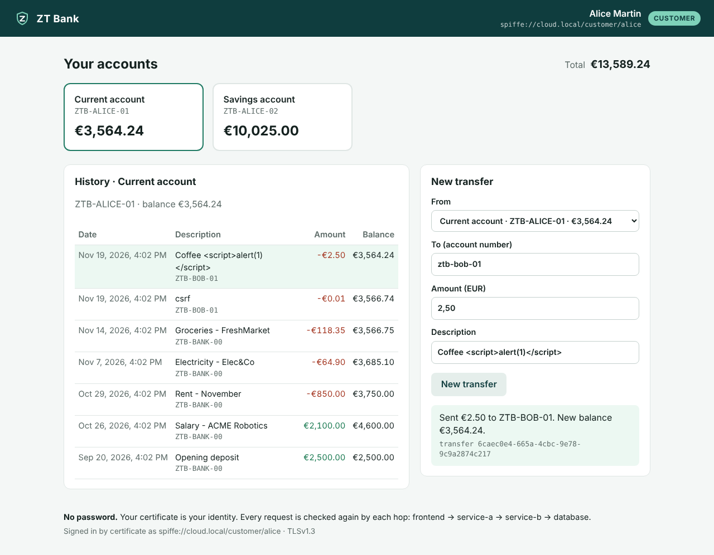
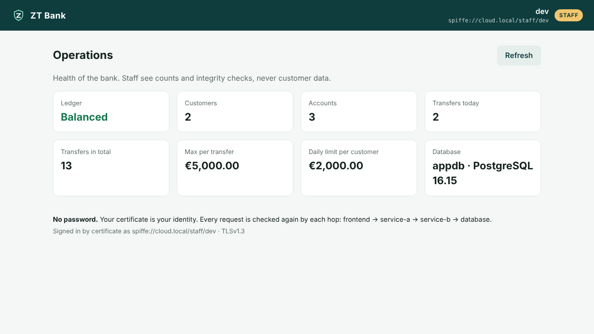
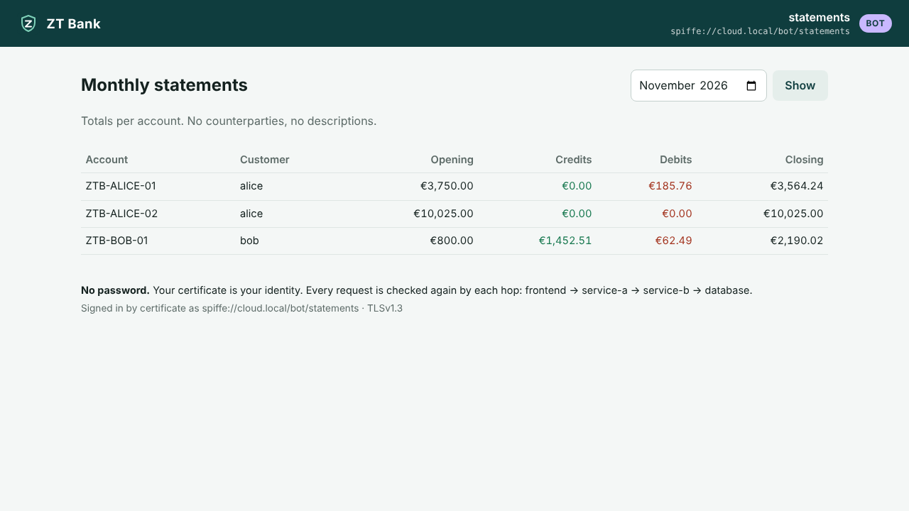

# 17 — Le site web et Firefox (étape 11)

`make client-certs`, `make test-11`.

| client (alice) | staff (dev) | bot (statements) |
|---|---|---|
|  |  |  |

(captures avec les données fictives de démonstration)

Une seule page (`ansible/roles/app/files/www/`), servie par le frontend sur
`https://10.20.0.10:8443/` à travers le tunnel. **Pas d'écran de connexion** : le navigateur
présente le certificat client de l'acteur pendant la poignée de main TLS et l'écran suit son rôle.
La page n'affiche que ce que renvoie l'API ; toutes les règles restent côté serveur.

## Protections

- **Pas d'injection de script** : `Content-Security-Policy: default-src 'self'; script-src 'self'; …`,
  aucun code en ligne, le JavaScript n'écrit que du texte (`textContent`, jamais `innerHTML`).
  Une description `` s'affiche comme du texte.
- **Pas de CSRF** : un navigateur présente le certificat à la banque quel que soit le site qui le
  lui demande. Le frontend refuse tout POST qui n'est pas du JSON (**415** : un formulaire d'un autre
  site ne peut pas envoyer de JSON sans requête préliminaire CORS, à laquelle rien ne répond) ou dont
  `Origin` / `Sec-Fetch-Site` n'est pas la banque (**403**) ; journalisé, jamais transmis.
- **Nouvelles tentatives sûres** : chaque virement porte une clé d'idempotence aléatoire.
- Fichiers appartenant à root, en lecture seule pour le service, sur le frontend uniquement.

## Firefox sur le poste distant

`make client-certs` écrit pour chaque acteur exporté (`alice`, `dev`) :
`build/export/remote-client/<acteur>/` avec `<acteur>.p12` (clé + chaîne, AES-256),
`p12-password.txt`, `root_ca.crt`, `client.crt`, `client.key` et `FIREFOX.txt` (guide pas à pas
avec l'URL et l'empreinte de la racine à vérifier). Un profil Firefox par identité.
Procédure d'import en ligne de commande : [19 — Le poste distant](19-poste-distant.md).

**Tests** : hors ligne, `tests/unit/test_web_ui.py` pilote un **vrai Chrome** (Playwright, si
installé) authentifié par un certificat seulement (écran de chaque rôle, Bob bloqué, aucune
violation CSP, une page d'attaque sur une autre origine ne peut pas payer) ;
`test_browser_bundle.py` importe le `.p12` avec NSS (la bibliothèque de Firefox). En direct,
`tests/web/` vérifie le site déployé, le CSRF sur la vraie chaîne et les paquets exportés.
