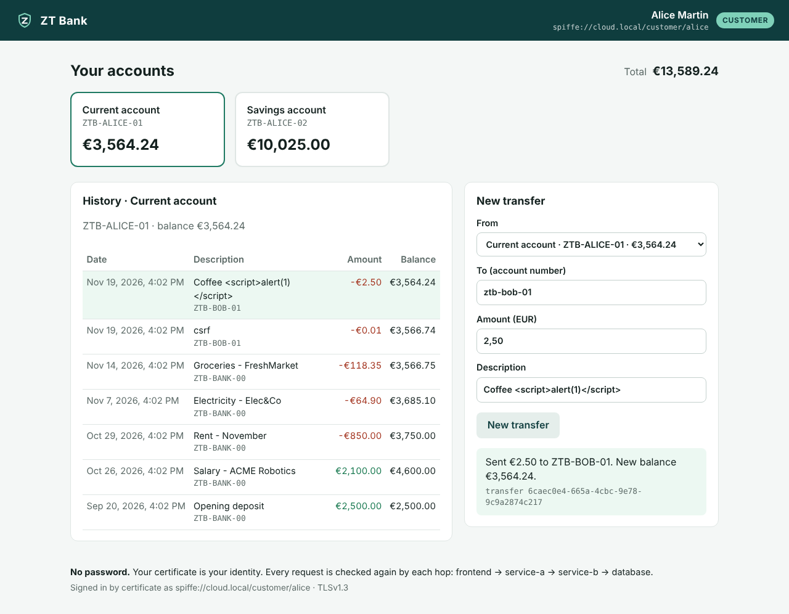
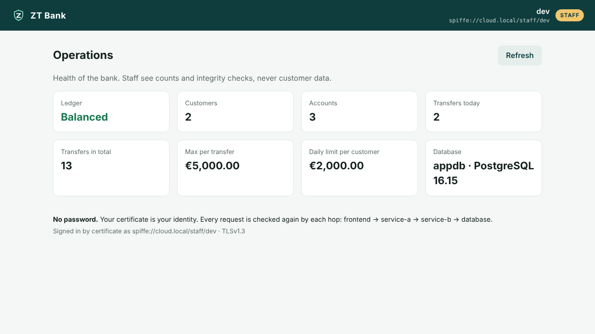
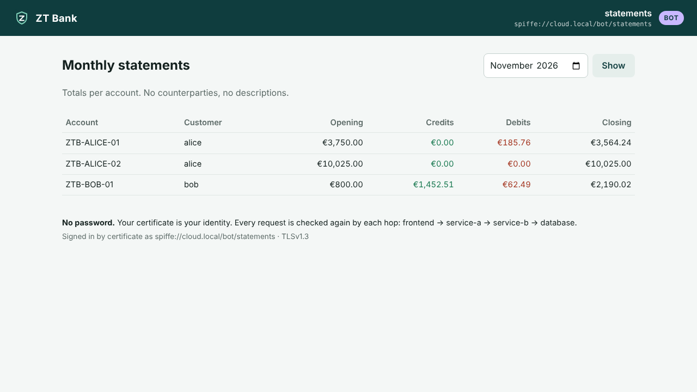

# Stage-by-stage reference (English)

The detailed, stage-by-stage reference of the project: what each `make` target changes and what each
`make test-N` proves. The project overview is in the [README](../README.md); the French documentation
(analysis, reproduction guide, one sheet per part) is in [docs/README.md](README.md).

## Two files, two jobs

| File | Versioned | Contains |
|---|---|---|
| `policy.yaml` | yes | networks, VMs and their IPs, services, allowed flows, PKI and WireGuard peers. Network-independent. |
| `env.yaml` | **no** (gitignored) | what depends on *this* machine: `entry_point` (a hostname, never an IP), `wan_interface`, `wan_port`, libvirt pool, SSH user/key. Copy it from `env.example.yaml`. |

Moving the cloud host to another Wi-Fi? Nothing changes. Different interface name
(e.g. Ethernet)? Change `wan_interface` in `env.yaml` and re-run `make up`:
only the host DNAT and the exported client template change; every VM ruleset
stays byte-identical (this is tested).

## The generator

`tools/gen_rules.py` reads both files and writes `build/` (gitignored):

- `nodes/<vm>/nftables.conf`: default **drop** on input/forward/output, drops logged, rules on every VM
- `nodes/<vm>/mtls.json`: SPIFFE identity, the IDs allowed to call each service, expected ID of each upstream
- `nodes/database/pg_hba.conf`, `pg_ident.conf`: `hostssl ... cert clientcert=verify-full`, service-b only
- `host/nftables-zt.conf`: DNAT `iifname "<wan_interface>" udp dport <wan_port>` to the gateway
- `wireguard/*.j2`: server and client configs (keys are injected by Ansible, never committed)
- `terraform.tfvars.json`, `inventory.yml`: so Terraform and Ansible never repeat an IP
- `matrix.json`: every source × every listening port, with the expected verdict (the drift test)

It refuses: an IP as `entry_point`, infra flows outside mgmt, business flows on
mgmt, IPs outside their network, duplicate IPs, flows between VMs that share
no network (VMs are never routed; only the gateway forwards, and only
tunnel → frontend:8443).

## Quick start

```bash
cp env.example.yaml env.yaml   # set wan_interface (ip -br link) and entry_point (<hostname>.local)
make up                        # everything, in the safe order (sudo password asked once, stage 1)
make test                      # every stage's tests, in order, stops at the first failure
```

Stage by stage (each `make <stage>` is idempotent, each `test-N` checks it):

| Stage | Build | Test | What the tests prove |
|---|---|---|---|
| 0 | `make gen` | `make test-0` | policy valid, generated rules exact, mTLS service + 4 refusals (offline) |
| 1 | `make host` | `make test-1` | cloud-host ready: DNAT by interface name, apt cache, mDNS name resolves |
| 2 | `make infra` | `make test-2` | networks isolated, 6 VMs, exact IPs/routes, nothing routed |
| 3 | `make ca` | `make test-3` | step-ca: TLS 1.3, 24h max, issues only the policy's identities |
| 4 | `make firewall` | `make test-4` | default drop everywhere, logged, N×N probes from VMs and the cloud host |
| 5 | `make wireguard` | `make test-5` | handshake, tunnel → frontend:8443 only, impersonation fails |
| 6 | `make certs` | `make test-6` | SPIFFE certs on every mTLS VM, 24h, renewal timer, single-use tokens |
| 7 | `make services` | `make test-7` | client → frontend → A → B → DB works; no cert / other CA / unlisted ID / expired refused |
| 8 | — | `make test-8` | tcpdump: no clear text on any bridge; TLS 1.3 everywhere; drift + full N×N |
| 9 | `make certs services` | `make test-9` | each actor × each route: allowed, 403 (logged) or 404, exactly as the policy says |
| 10 | `make services` | `make test-10` | ZT Bank live: own accounts only, IDOR → 404, transfers, replay-safe, RLS + append-only in the real DB, audit |
| 11 | `make services client-certs` | `make test-11` | the website through the tunnel (strict CSP, repo files, read-only), CSRF refused + logged, Firefox bundles for the remote client |
| 12 | `make host wireguard firewall services client-certs bot` | `make test-12` | the bot (own netns, device-bound certificate, rate limits) and the partner webhook from outside without VPN (signature, time window, anti-replay) |
| 13 | `make ca services` | `make test-13`, `make attacks` | live attacks A1–A11 (revocation within a minute and fail-closed, compromised frontend contained, full port scans), audit report; B1–B6 from the remote client |

The Ubuntu cloud image is downloaded once by `make image` (resumable, checked against
Ubuntu's SHA256SUMS) into `~/.cache/zerotrust/`; `make infra` uploads that local copy, so a
`make destroy && make up` never downloads it again.

Other targets: `make destroy` (VMs and networks; host prep stays), `make recreate-vms`,
`make test-peer` / `make test-peer-down` (the tunnel test client), `make revoke`, `make audit`,
`make demo`, `make clean`.
SSH to any VM over mgmt: `ssh -F build/ssh_config frontend`.

## Host preparation (stage 1) — what `make host` changes on the cloud host

| Change | Why |
|---|---|
| installs qemu-kvm, libvirt, avahi-utils, libnss-mdns, apt-cacher-ng, wireguard-tools, tcpdump | VMs, `entry_point` over mDNS, packages for the isolated VMs, tests |
| stops + disables libvirt's `default` network (refuses if a VM uses it) | it uses 192.168.122.0/24, the range of `zt-wan` |
| `net.ipv4.ip_forward=1` in `/etc/sysctl.d/90-zerotrust.conf` | DNAT from the Wi-Fi to the gateway VM |
| avahi `allow-interfaces=<wan_interface>` | announce `entry_point` only on the client-facing interface, not on Docker/libvirt bridges |
| nftables table `inet zt_host` (own table, **never** `flush ruleset`, never default-drop) | DNAT `iifname "<wan_interface>" udp dport <wan_port>` → gateway; apt cache reachable only from `virbr-zt-mgmt` |
| `/etc/libvirt/hooks/network.d/zerotrust` (+ libvirtd drop-in) | libvirt's NAT chain `LIBVIRT_FWI` rejects new inbound traffic, and an accept in another table cannot override a reject. libvirt rebuilds that chain at will, so the single WireGuard accept is placed in `FORWARD` **before the jump** to `LIBVIRT_FWI` (libvirt never reorders that jump). Re-applied at boot, on network start and on libvirtd start |
| `zerotrust-host.service` | re-applies both at boot, after libvirtd and docker |

Docker coexists: its rules are not touched (its FORWARD policy only affects its own bridges).
Undo: `sudo systemctl disable --now zerotrust-host` and `sudo rm /etc/libvirt/hooks/network.d/zerotrust`.

## Networks and VMs (stage 2)

`terraform/` reads only `build/terraform.tfvars.json`. Provider: `dmacvicar/libvirt ~> 0.8.3`
(the 0.9 line is a rewrite with a still-moving schema).

| libvirt network | mode | host address | role |
|---|---|---|---|
| zt-wan (virbr-zt-wan) | nat | 192.168.122.1 | only the gateway; target of the DNAT |
| zt-dmz / zt-app / zt-data | isolated (`none`) | **none** (pure L2) | data planes, the host cannot reach them |
| zt-mgmt (virbr-zt-mgmt) | isolated | 10.50.0.1 | SSH/Ansible, step-ca enrolment, apt cache |

No DHCP and no DNS on any network. Each VM gets static addresses from cloud-init
(netplan matched by MAC, NICs renamed `wan0 dmz0 app0 data0 mgmt0`), IPv6 off,
`rp_filter=1`, redirects off, `ip_forward=1` only on the gateway. Only two routes
exist in the whole cloud: the gateway's default route via the libvirt NAT and the
frontend's route back to the tunnel via the gateway.

## Internal CA (stage 3)

step-ca runs on the CA VM, as an unprivileged `step` user under a hardened systemd unit,
listening **only** on its mgmt address (`10.50.0.10:9000`), **TLS 1.3 only**.

- Packages: downloaded once on the cloud host (`build/artifacts/`, VMs have no internet), override
  the URLs in `env.yaml` (`step_cli_deb_url`, `step_ca_deb_url`) to pin a version.
- Secrets: the key password and the JWK provisioner password are random, generated by
  Ansible into `ansible/.secrets/` (0600, gitignored) and copied 0400 to the CA.
- Lifetime: `defaultTLSCertDuration = maxTLSCertDuration = 24h` (from `policy.yaml: cert.lifetime`);
  renewal over mTLS with the current certificate, never after expiry.
- **Issuance policy** (`build/pki/pki.json`, generated from `policy.yaml`): the CA itself refuses
  any URI outside `spiffe://cloud.local/…`, any name that is not a declared identity, any IP
  that is not a declared data-plane address (mgmt can never be certified), and any lifetime > 24h.
- Trust anchor: `build/pki/root_ca.crt` + `root_ca.fingerprint` (checked against the CA by the tests).

Identities (SPIFFE ID → SANs) exist only for nodes that take part in an mTLS flow
(frontend, service-a, service-b, database) and the tunnel clients (`client/remote-client`, `client/test-peer`).

## Firewall on every VM (stage 4)

Each VM loads `build/nodes/<vm>/nftables.conf` (generated from `policy.yaml`): one table
`inet zt`, **policy drop** on input, forward and output, conntrack for replies, and a
rate-limited `log` before every drop (`journalctl -k | grep zt-drop-`). A flow is open only
if both ends allow it: the source's output chain and the destination's input chain.

Anti lock-out, three layers:
1. SSH from the cloud host over mgmt is part of the policy (`infra: admin-ssh`, unit-tested on every VM).
2. `ssh` is the only service with `stateless_replies: true`: the VM may answer the cloud host from
   port 22 even without conntrack state. Needed because the Ansible session that loads the
   *first* ruleset was opened before conntrack existed; its next reply is classified `new`
   and would otherwise be dropped (this happened, and was reproduced, before the fix).
3. `zt-nft-apply` saves the live ruleset, arms a 120 s rollback timer, loads the new rules;
   Ansible then opens a *fresh* SSH connection and runs `--confirm`, which **fails** if the
   rollback already fired or if the expected tables are not live (and leaves the rollback
   armed). A ruleset that cuts SSH undoes itself and the play fails loudly.

Tests probe real TCP connections for every source x destination x port of
`build/matrix.json`: allowed = handshake or RST (nothing listening yet), denied = timeout
or no route. The cloud host has SSH only: it cannot reach the CA, and that is tested too.

## WireGuard (stage 5)

`make wireguard`:
- generates on the cloud host, once, a key pair per node/peer and a pre-shared key per peer in
  `ansible/.secrets/wireguard/` (0600, gitignored, never overwritten);
- fills `build/wireguard/gateway-wg0.conf.j2` (generated from the policy, keys as Jinja
  placeholders) into `/etc/wireguard/wg0.conf` on the gateway (0600), `wg-quick@wg0` at boot;
- writes one client config per peer to `build/export/<peer>/wg0.conf` (0600).

**The remote client side is not managed here.** The only thing produced for it is
`build/export/remote-client/wg0.conf`: `Endpoint = <entry_point>:<wan_port>` (the mDNS name, never an
IP), `AllowedIPs = 10.20.0.10/32` (only what the policy lets the tunnel reach). Copy it to the
remote-client over a trusted channel (USB stick, `scp`), as `/etc/wireguard/wg0.conf`, then delete the copy.

Path of a packet from the remote client: Wi-Fi → cloud-host `wan_interface` → DNAT (matched by interface name) →
`192.168.122.10:51820` → gateway `wg0` → nftables forward allows **only** `frontend:8443` →
frontend, which sees the real tunnel address (no NAT on the gateway).

**Test peer.** `tools/zt-test-peer` builds a network namespace `zt-peer` on the cloud host whose only
interface is a tunnel to the gateway (10.10.0.200). Unlike the remote client it routes *every* policy
network into the tunnel, so each refusal is proven by the gateway, not by the client's routes.
It talks to the gateway directly on the NAT network: a machine cannot send its own traffic in
through its own Wi-Fi card, so the DNAT itself is checked from the remote client (below).

Tests also try to impersonate: the remote client's tunnel address from the test peer's key (dropped:
each key owns its /32), an unknown key, and the test peer's private key without its PSK
(no handshake, no answer).

### Check from the remote client (manual, once)

```bash
sudo wg-quick up wg0
sudo wg show wg0 latest-handshakes        # a recent timestamp
nc -vz -w 3 10.20.0.10 8443               # succeeded / refused = reachable (service comes in stage 7)
```
On the cloud host, `ssh -F build/ssh_config gateway sudo wg show wg0 endpoints` lists the remote client's own LAN
address for its key: the packets came in through the DNAT, unmasqueraded.

## Certificates (stage 6)

`make certs`, for every VM with an mTLS identity (`frontend`, `service-a`, `service-b`, `database`):
- the private key is generated **on the VM** by `step ca certificate` and never leaves it;
- enrolment uses a **one-time token** minted on the CA VM (5 minutes, bound to the identity's
  SANs; the provisioner password never leaves the CA; a replayed token is refused — tested);
- certificate: `CN=<vm>`, URI SAN `spiffe://cloud.local/<vm>`, data-plane IPs only, **24h**;
- `/etc/zt/pki/` = `cert.crt` (leaf + intermediate), `cert.key` (root:zt-tls 0640), `root_ca.crt`;
- `zt-cert-renew.timer` checks hourly and renews over mTLS (the current cert proves the identity)
  once less than **8h** is left, then reloads the service. Renewal after expiry is disabled on
  the CA: a VM switched off for more than 24h is re-enrolled by `make certs`.

Tunnel clients (`client/remote-client`, `client/test-peer`): key generated on the cloud host
(`ansible/.secrets/pki/`, 0600), only the CSR goes to the CA. The remote client copy is exported to
`build/export/remote-client/` (`client.crt`, `client.key`, `root_ca.crt`) next to its `wg0.conf`.
It also lives 24h: run `make certs` and copy it again before using the remote client.

## Services (stage 7)

- **zt-mtls** (`ansible/roles/app/files/zt-mtls`, Python stdlib) runs the frontend proxy and
  service-a/b from the generated `mtls.json`. As a server: TLS 1.3 only, client certificate
  required and verified against the root; then the caller's SPIFFE ID must be in the allowlist
  and its address in the declared sources, else **403**. As a client: TLS 1.3, its own cert, the
  server's IP SAN *and* SPIFFE ID are checked before the request is sent. Unprivileged user,
  hardened systemd unit, every refusal logged (`journalctl -u zt-mtls | grep refused`).
- **PostgreSQL**: listens on 10.40.0.10 only, `ssl_min_protocol_version = TLSv1.3`;
  `pg_hba.conf` (generated) has a single `hostssl appdb service_b 10.40.0.11/32 cert` line;
  `pg_ident.conf` maps the certificate CN `service-b` to the role `service_b`, which has no
  password and `SELECT` on one table.
- `GET https://10.20.0.10:8443/chain?marker=x` walks the whole chain and returns what every hop
  saw (caller identity, TLS version, the database's `current_user` and client DN).

From the remote client, once the tunnel is up:
```bash
curl --cacert root_ca.crt --cert client.crt --key client.key https://10.20.0.10:8443/chain?marker=hello
```

## Confidentiality and drift (stage 8)

- `tests/final/test_confidentiality.py`: tcpdump on **every** `virbr-zt-*` bridge while a random
  marker crosses tunnel → frontend → A → B → database (which echoes it). The marker must appear
  in no capture. Guards: a clear-text control packet on mgmt **must** be captured (the capture
  works), and each hop's packets (51820/udp, 8443, 9443, 5432) must be present (they were seen,
  encrypted). TLS 1.2 is refused by every server, PostgreSQL included.
- `tests/final/test_drift.py`: `build/` equals a fresh generation from `policy.yaml`; every live
  config generated from it is identical on its machine (nftables on the 6 VMs and the cloud host,
  `mtls.json`, `pg_hba`/`pg_ident`, WireGuard peers, CA issuance policy); and the **full N×N
  matrix** (6 VMs + the cloud host + a tunnel client × every address × every policy port) is probed:
  the reachable set must be *exactly* the declared flows, every declared flow must hit a live
  service, and no deny may answer. Report: `build/drift-report.json`.

## Changing the policy

Edit `policy.yaml` (e.g. add a flow), then `make check && make test-0` (offline), then
`make firewall services` (or `make up`), then `make test`. The generator rewrites rules,
allowlists, `pg_hba` and the expected matrix together, so the tests follow the change.

## Troubleshooting

| Symptom | Look at |
|---|---|
| a flow times out | `ssh -F build/ssh_config <vm> sudo journalctl -k \| grep zt-drop` (both ends) |
| mTLS refused | `ssh -F build/ssh_config <vm> sudo journalctl -u zt-mtls \| grep refused` |
| certificate expired (VM was off > 24h) | `make certs` |
| firewall change locked SSH out | wait 2 min: the VM rolls back by itself; `make firewall` reports it |
| remote-client tunnel does not come up | `avahi-resolve -4 -n <entry_point>` on the remote client; `sudo wg show` on both ends |
| database refuses | `ssh -F build/ssh_config database sudo journalctl -u postgresql@*` |

## Actors and per-route permissions (stage 9)

The cloud now runs **ZT Bank**. `policy.yaml` declares *who* uses it (`actors`, each with a
`role`) and *what* each role may do on each service (`routes`, default deny):

| Actor | Identity | Role | May (frontend) | Machine |
|---|---|---|---|---|
| alice | `spiffe://cloud.local/customer/alice` | customer | her accounts, history, transfers | remote-client (`build/export/remote-client/alice/`) |
| bob | `spiffe://cloud.local/customer/bob` | customer | same, for his own money | test client on the cloud host |
| dev | `spiffe://cloud.local/staff/dev` | staff | `/api/status`, `/health`, `/chain` — never customer data | remote-client (`build/export/remote-client/dev/`) |
| statements | `spiffe://cloud.local/bot/statements` | bot | `/api/statements`, `/health`; **1 h** certificate | test client on the cloud host |

The generator turns the routes into each service's `mtls.json`; `zt-mtls` then answers
**404** to a method + path the policy does not declare, **403** to a declared route that is not
open to the caller (logged with the caller's identity), and serves the rest. Inner services only
accept their upstream node, and only on their own declared routes.

Same machine, different rights: Alice and Dev both work from the remote client, through the same tunnel;
their certificates, not the network, decide what they can do.

Client certificates are re-issued by `make client-certs` (also run before tests 6–9) when less
than 8 h are left — or a third of a shorter lifetime (20 min for the bot's 1 h certificate).

## ZT Bank — the application (stage 10)

```
actor (certificate) ─► frontend: web ─► service-a: core ─► service-b: ledger ─► PostgreSQL
                       identity from      validation,        the only DB client;   RLS, append-only,
                       the cert only      roles, limits      reads under RLS       bank.transfer()
```

| API (frontend) | Who | What |
|---|---|---|
| `GET /api/me` | everyone | who am I (actor, role, customer) |
| `GET /api/accounts` | customers | own accounts, balances, total |
| `GET /api/accounts/<id>/transactions` | customers | history with running balance; someone else's account = **404**, like a missing one |
| `POST /api/transfers` | customers | `{"from","to","amount":"12.50","description","idempotency_key"}`; same key again = same transfer, paid once |
| `GET /api/statements?month=2026-11` | bot | opening / credits / debits / closing per account, no counterparties |
| `GET /api/status` | staff | counts, ledger integrity, limits — never customer data |

**Who is who.** The frontend takes the acting identity, role and customer **only from the client
certificate**; identity headers sent by a client are ignored (tested). Inner services receive the
identity in `X-ZT-*` headers, which they accept only because nothing but their upstream node can
reach them (firewall + mTLS + routes), and they re-check the role anyway.

**Inside the database** (`ansible/roles/postgres/templates/bank.sql.j2`):
- tables owned by `bank_owner` (no login); the application role can only `SELECT` — under
  **row-level security** keyed on the transaction setting `zt.customer` (unset → no rows) — and
  call three functions. It has no `INSERT`/`UPDATE`/`DELETE` anywhere.
- money moves only through `bank.transfer()`: ownership of the source account, positive amount,
  maximum per transfer and **daily limit** (from `policy.yaml`), sufficient funds under a **row
  lock** (no double spend: tested with concurrent transfers, and the test fails if the lock is
  removed), **idempotency key** (a retry never pays twice), **double entry** (one debit + one
  credit), and an **audit** row carrying the actor's SPIFFE ID.
- the ledger is **append-only**: a trigger refuses `UPDATE`/`DELETE`/`TRUNCATE`, even for the DBA.

Every refusal is logged at each layer with the **real actor** (`denied spiffe://…/customer/bob via
spiffe://…/frontend GET /accounts/ZTB-ALICE-01/…: 404`). Demo data: `ansible/roles/postgres/files/seed.yaml`.

Offline, `tests/unit/test_bank_sql.py` and `tests/unit/test_bank_app.py` run the schema and the
whole chain (real programs, generated routes, PostgreSQL with certificate authentication) when
PostgreSQL is installed (`ZT_TEST_PG_DSN` / `ZT_TEST_PG_RUNAS`, see the files); otherwise skipped.

## The website, and Firefox on the remote client (stage 11)

| customer (alice) | staff (dev) | bot (statements) |
|---|---|---|
|  |  |  |

One page (`ansible/roles/app/files/www/`), served by the frontend at `https://10.20.0.10:8443/`
through the tunnel. **There is no login**: the browser presents the actor's client certificate in
the TLS handshake and the screen follows the role in it. The page only renders what the API
returns; every rule stays on the server side.

- **No script injection.** `Content-Security-Policy: default-src 'self'; script-src 'self'; style-src 'self'; frame-ancestors 'none'…`,
  no inline code at all, and the JS writes text only (`textContent`, never `innerHTML`). A
  description like `<script>alert(1)</script>` is shown as text (tested in a real browser).
- **No cross-site request forgery.** A browser sends the client certificate to the bank whoever
  asks it to, so a page from another site could try to make it pay. The frontend refuses any POST
  that is not JSON (`415`: a cross-site `<form>` cannot send JSON without a CORS preflight, which
  nothing answers) or whose `Origin` / `Sec-Fetch-Site` is not the bank itself (`403`); logged with the
  real actor, never forwarded to core banking.
- **Safe retries.** Each transfer carries a random idempotency key; after a network failure,
  pressing *Send* again re-uses it, so the bank pays once.
- Files are root-owned and read-only for the service user, on the frontend only.

**Firefox on the remote client.** `make client-certs` writes, for every actor with `export_to: remote-client`,
`build/export/remote-client/<actor>/`: `<actor>.p12` (key + certificate chain, AES-256, random password
generated on the cloud host in `ansible/.secrets`, never committed), `p12-password.txt`, `root_ca.crt` and
`FIREFOX.txt`, a step-by-step guide with the URL and the root's fingerprint to check. One Firefox
profile per identity (`firefox -P`) to be alice in one window and dev in another. Certificates live
24 h: run `make client-certs` again and re-send the new `.p12`.

Tests: offline, `tests/unit/test_web_ui.py` drives a **real Chrome** (Playwright, when installed)
logged in by nothing but a client certificate: each role's screen, Bob blocked from Alice's
account, no CSP violation, and an attacker's page on another origin trying a form and a `fetch`
POST: refused, nothing paid. `tests/unit/test_browser_bundle.py` runs the playbook's bundle task
and imports the result with NSS's `pk12util` (Firefox's own crypto library). Live,
`make test-11` checks the deployed site, CSRF on the real chain and the exported bundles.

## The edges: the statements bot and the payment partner (stage 12)

```
 cloud-host netns zt-bot ──wg (own key, 10.10.0.3)──► gateway ─[≤5 new conn/s]─► frontend:8443 ─► … (statements)
 PayFlow (internet, no VPN) ─► cloud-host Wi-Fi:8444 ─DNAT─► gateway ─DNAT+SNAT─► frontend:8444 /webhook ─► core ─► ledger
```

**The bot** (`tools/zt-bot.py`, `make bot-run`) lives in its own network namespace on the cloud host whose
only interface is its own WireGuard peer, routed to the frontend and nothing else. Its 1-hour
certificate is **bound to that device** (`device: bot` in `policy.yaml`): the same certificate
presented from any other tunnel address gets 403 — a stolen bot key is useless elsewhere. The bot
renews by asking the admin's Ansible (`make bot-run` = `client-certs` + one run); it holds no
standing credential to the CA, which stays unreachable from the cloud host.

**Rate limits**, from `policy.yaml`:
- per identity at the frontend (`roles.<role>.rate_limit`: customer/staff 240/min, bot 20/min,
  partner 60/min): token bucket, `429` + `Retry-After`, logged once per burst with the identity;
  another identity is not affected;
- per peer at the gateway (`wireguard.peers[].conn_limit`, bot: 5 new connections/s, burst 10):
  even a compromised bot cannot flood the bank.

**The partner** calls from the internet, without the VPN. One more port is published (8444,
matched by interface name on the cloud host, never by address); the gateway translates it to the
frontend's partner listener, which only ever sees the gateway's address and accepts only the
partner's certificate and only `POST /webhook`. Each call is then checked in this order:

| check | where | refused with |
|---|---|---|
| certificate = the partner | zt-mtls (frontend) | handshake / 403 |
| HMAC-SHA256(secret, `timestamp.nonce.body`) | frontend | 401 bad signature (also any change of the body) |
| timestamp within ±300 s | frontend, and again in the database | 401 |
| nonce never seen before | **database** (`bank.partner_nonces`) | 409 replayed request |
| reference already credited | database (`bank.incoming`) | same values: 200 `replayed`, paid once; other values: 409 |
| destination is a customer account, amount ≤ limit | core banking + database | 404 / 422 |

The secret is generated on the cloud host (`ansible/.secrets/partners/`, never committed, never logged) and
deployed to the frontend only (root:zt-app 0640). Money moves by double entry from the partner's
settlement account (`ZTB-PAYFLOW-00`), audited with the partner's SPIFFE ID.

Try it: `make pay TO=ZTB-ALICE-01 AMOUNT=10.00`, then the attacks:
`python3 tools/payflow.py --to ZTB-ALICE-01 --amount 1 --replay` (or `--skew -900`, `--tamper`,
`--wrong-secret`). From the remote client (no VPN needed): copy the partner's certificate, key, secret and the
root, and use `--url https://<entry_point>:8444/webhook`.

Tests: offline, `tests/unit/test_partner.py` (webhook, replay, window, signature, roles re-checked,
device binding, rate limit on the real services + PostgreSQL), `test_bank_sql.py` (the database
alone refuses replays), `test_edge_generated.py` (NAT, limits, validation). Live, `make test-12`.

## Attacks, revocation and audit (stage 13)

Everything above is now attacked on purpose. The **attack catalogue**
(`tests/attacks/catalogue.yaml`, `make attack-list`) names, for each attack, the attacker, the goal,
the defence and the live tests that prove the defence; the threat model and its residual risks are
in [`docs/THREAT-MODEL.md`](THREAT-MODEL.md).

| | Attack | Cloud host | Remote client |
|---|---|---|---|
| A1 | stolen laptop: a copy of Alice's certificate | revoked → refused everywhere in ≤ 60 s, Alice's own still works, CA refuses renewal, fail-closed | B6 (live with Firefox) |
| A2 | root on the frontend | reaches only service-a / CA / apt cache, holds no other key, refused by the ledger | — |
| A3 | lateral movement from the VPN, spoofed tunnel address | gateway: tunnel → website only | B3 |
| A4 | forged identities (own CA, expired, none, another one) | refused at the handshake or by the allow-list | B2 |
| A5 | full TCP port scans, from the tunnel and from outside | only 8443 in the tunnel, only 8444 outside; silent drops, logged | B1 |
| A6 | stolen/guessed WireGuard key without the PSK | no answer | — |
| A7 | customer overstepping: IDOR, forged headers, other roles | 404 / ignored / 403, RLS | B4 |
| A8 | CSRF from a malicious page | 415 / 403, never forwarded | B4 |
| A9 | forged / replayed payment notification | partner mTLS, HMAC, ±300 s, nonce + reference once | B5 |
| A10 | flooding | 429 per identity, connection limit per peer | — |
| A11 | eavesdropping, TLS 1.2 / plaintext | TLS 1.3 everywhere, PostgreSQL included | — |

```bash
make test-13              # the new live attacks: A1 (revocation), A2 (compromised frontend), A5 (scans)
make attacks              # the whole catalogue A1-A11 -> build/reports/attacks.md (+ .json), exit 1 on any BREACH
make attack A=1,5         # some of them
make revoke ACTOR=alice [REASON="stolen laptop"]    # or NODE=frontend: revoke now
make audit [SINCE="2 hours ago"]                    # -> build/reports/audit.md, exit 1 on any finding
make demo                 # narrated walk-through, revocation of Alice live with the remote client
```

**Revocation.** step-ca keeps a CRL (`generateOnRevoke`). On every mTLS VM, `zt-crl` (systemd
timer, every minute) fetches it pinned to our root, checks its signature, refuses an older CRL
number (rollback), and publishes the revoked serials; `zt-mtls` refuses a revoked caller (403,
logged with the serial) and a revoked upstream (502), without restarting. No list or a stale one
(past the CRL's next update): **everyone** gets 503 — fail-closed. `make revoke` mints a one-time
revocation token on the CA (its password never leaves the VM), revokes, refreshes every service at
once; for an actor it sets the old key aside (`ansible/.secrets/pki/<cn>/revoked/<serial>/`) so
`make client-certs` issues a new key and certificate, and the Firefox bundle is rebuilt.
For a VM: `make revoke NODE=service-a` then `make certs` (re-enrols it with a new key).

**Remote client.** The friend runs the B checks from the repository, nothing to install:
`git pull && python3 remote-client/attack.py` (see [`remote-client/README.md`](../remote-client/README.md)).
Every address is read from `policy.yaml`; the report `remote-client-report.json` goes back to the
cloud host's `build/reports/` and into `make audit`. Remember: the remote client's certificates live
24 h — after `make client-certs`, send `build/export/remote-client/{alice,dev}/` again.

**Audit.** `make audit` reads, over SSH and read-only: requests per identity, every refusal with
its reason, the CRL in force on each service, certificate expiry (VMs and actors), the nftables
drops of every VM, step-ca's activity, the bank's audit table and the ledger balance, and the
latest attack reports. It flags: a stale or diverging CRL, an unbalanced ledger, an attack not
defended, an unreachable VM.

Tests: offline, `tests/unit/test_revocation.py` (real `zt-crl` on a real CRL, signature, rollback,
other signer; revoked caller and upstream refused on the real services; fail-closed),
`test_attack_suites.py` (catalogue ↔ tests, the runner's verdicts, the scanner, and the remote
client's checks against the real services: DEFENDED, and BREACH when a defence is missing),
`test_audit.py`. Live, `make test-13` and `make attacks`.
