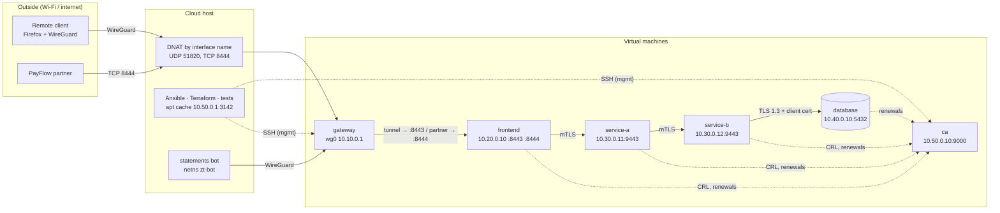

# Architecture

## Components

| Component | Runs on | Role | Document |
|---|---|---|---|
| Cloud host | the laptop | hypervisor, DNAT by interface name, apt cache, mDNS, Ansible/Terraform/tests | [cloud-host.md](cloud-host.md) |
| Gateway | VM 1 | WireGuard termination; the only router; tunnel → frontend:8443 only | [gateway.md](gateway.md) |
| Frontend | VM 2 | website and API (:8443), partner API (:8444), all edge checks | [frontend.md](frontend.md) |
| Service-a (core) | VM 3 | business rules, role re-check | [service-a.md](service-a.md) |
| Service-b (ledger) | VM 4 | the only database client | [service-b.md](service-b.md) |
| Database | VM 5 | PostgreSQL 16: RLS, append-only ledger, money-moving functions | [database.md](database.md) |
| CA | VM 6 | step-ca: 24 h SPIFFE certificates, issuance policy, CRL | [ca.md](ca.md) |
| Revocation (`zt-crl`) | VMs 2–4 | CRL fetch, signature check, fail-closed enforcement | [revocation.md](revocation.md) |
| Statements bot | cloud host netns `zt-bot` | machine actor with a device-bound 1 h certificate | [statements-bot.md](statements-bot.md) |
| PayFlow partner | internet (simulated) | signed payment webhook, no VPN | [payflow-partner.md](payflow-partner.md) |
| Remote client | second laptop | users' workstation (Firefox, WireGuard); attack suite B1–B6 | [`remote-client/README.md`](../remote-client/README.md) |

## Data path and control path

Solid arrows: data path (the only business flows the firewalls allow). Dotted arrows: control path,
on the isolated mgmt network only.

## Networks and trust boundaries

| Network | CIDR | Mode | Members | Boundary enforced by |
|---|---|---|---|---|
| wan | 192.168.122.0/24 | libvirt NAT | gateway, cloud host (.1) | cloud host DNAT by interface name; gateway nftables |
| tunnel | 10.10.0.0/24 | WireGuard | remote client .2, bot .3, test peer .200 | keys + PSK; each key owns its /32; gateway forwards to frontend:8443 only |
| dmz | 10.20.0.0/24 | isolated (no host address) | gateway .1, frontend .10 | nftables on both; mTLS at the frontend |
| app | 10.30.0.0/24 | isolated | frontend .10, service-a .11, service-b .12 | nftables; mTLS allow-lists (frontend → a, a → b only) |
| data | 10.40.0.0/24 | isolated | service-b .11, database .10 | nftables; `pg_hba` single line, certificate auth |
| mgmt | 10.50.0.0/24 | isolated | every VM, cloud host .1, CA .10 | nftables: SSH from .1 only; CA and apt cache only |

Each hop crosses three independent checks: the network (default-drop nftables on every VM), the
transport (WireGuard outside, TLS 1.3 inside) and the identity (a valid, non-revoked SPIFFE
certificate in the receiver's allow-list, then a route open to the caller's role).

## One source of truth

[`policy.yaml`](../policy.yaml) (versioned) and `env.yaml` (per machine, not versioned) are compiled by
[`tools/gen_rules.py`](../tools/gen_rules.py) into `build/`: nftables per VM, host DNAT, `mtls.json`
per service, `pg_hba`/`pg_ident`, the CA issuance policy, WireGuard templates, Terraform variables, the
Ansible inventory and `matrix.json` (every source × destination × port with its expected verdict).
Terraform, Ansible and the tests read only `build/`; the drift tests compare the live system with a
fresh generation ([evidence/drift-summary.md](evidence/drift-summary.md)).

## Identities

| Identity | Holder | Lifetime | Where the key is generated |
|---|---|---|---|
| `spiffe://cloud.local/<vm>` | frontend, service-a, service-b, database | 24 h, renewed 8 h before expiry | on the VM |
| `spiffe://cloud.local/customer/{alice,bob}` | people | 24 h | cloud host (`ansible/.secrets/pki/`), exported to the remote client |
| `spiffe://cloud.local/staff/dev` | support | 24 h | cloud host, exported |
| `spiffe://cloud.local/bot/statements` | bot | 1 h, bound to 10.10.0.3 | cloud host |
| `spiffe://cloud.local/partner/payflow` | partner | 24 h | cloud host |

## Design decisions

| Decision | Reason | Consequence |
|---|---|---|
| firewall on every VM, not only at the edge | a compromised VM must not become a pivot | each flow needs both ends to allow it |
| identity from the certificate only | headers can be forged | the frontend ignores client identity headers |
| Python standard library for services | small, auditable security code | single-process servers, lab-scale performance |
| own CRL fetcher instead of OpenSSL CRL check | step-ca CRL scope rejected by OpenSSL | fail-closed list with rollback protection ([revocation.md](revocation.md)) |
| one VM per role on one laptop | hardware available | no redundancy ([high-availability.md](high-availability.md)) |
| no Wi-Fi address anywhere | the lab moves between networks | mDNS name for the client, interface-name DNAT on the host |

## Related documents

[deployment.md](deployment.md) · [security.md](security.md) · [testing.md](testing.md) ·
[high-availability.md](high-availability.md) · [THREAT-MODEL.md](THREAT-MODEL.md) · [STAGES.md](STAGES.md)
