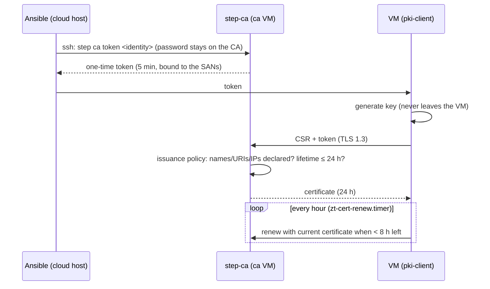

# Certificate authority (CA)

## 1. Purpose

The CA (step-ca) issues every identity in the system: 24-hour SPIFFE certificates for the VMs and
the actors, renewals, and the certificate revocation list. It exists so that identities are short-lived,
named only as the policy declares, and revocable within a minute.

## 2. Responsibilities and non-responsibilities

**Responsibilities**

- issue certificates for names, URIs and IP addresses declared in the policy only (issuance policy);
- cap lifetimes at 24 h; renew over mTLS with the current, unexpired certificate;
- sign enrolment requests that carry a one-time token minted on the CA itself;
- revoke on request (`make revoke`) and regenerate the CRL immediately; publish it at `/1.0/crl`.

**Non-responsibilities — it must NOT**

- listen on any network but mgmt, or accept TLS below 1.3;
- let its provisioner password or keys leave the VM;
- certify mgmt addresses (mgmt is never part of an identity).

## 3. Where it runs

| Item | Value |
|---|---|
| Host | VM `ca`, 1024 MB, mgmt only |
| Interface | `mgmt0` 10.50.0.10 |
| Listener | 10.50.0.10:9000 (HTTPS, TLS 1.3) |
| systemd unit | `step-ca.service`, user `step` |
| Files | `STEPPATH=/etc/step-ca`: `config/ca.json`, `certs/root_ca.crt`, `certs/intermediate_ca.crt`, `secrets/` (0400), `db/` |
| Version | TODO[measure]: `ssh -F build/ssh_config ca step-ca version` (the package is the latest release downloaded at build time by [`ansible/artifacts.yml`](../ansible/artifacts.yml)) |

## 4. Interfaces

| Direction | Peer | Protocol | Port | Authentication |
|---|---|---|---|---|
| in | every VM (`infra: pki`) | HTTPS, TLS 1.3 | 9000 | enrolment: one-time JWK token; renewal: current certificate (mTLS) |
| in | every mTLS VM (`zt-crl`) | HTTPS | 9000 | none needed (`GET /1.0/crl`); the CRL is signature-checked by the client |
| in | cloud host (Ansible over SSH) | SSH | 22 | SSH key; CSR signing for actors and revocation tokens are run on the CA |

## 5. Configuration

| Name | Default | Description |
|---|---|---|
| `trust_domain` in [`policy.yaml`](../policy.yaml) | `cloud.local` | SPIFFE trust domain |
| `cert.lifetime` | `24h` | default and maximum certificate lifetime |
| `cert.renew_before` | `8h` | renewal threshold (VM timers) |
| `actors.statements.cert_lifetime` | `1h` | the bot's short-lived certificate |
| provisioner | `zt-jwk` (JWK) | token-based enrolment |
| `crl` in `ca.json` | `enabled: true, generateOnRevoke: true, cacheDuration: 24h0m0s` | revocation list, set by [`ansible/roles/ca/tasks/main.yml`](../ansible/roles/ca/tasks/main.yml) |
| `build/pki/pki.json` | generated | identities and SANs, issuance policy |
| `ansible/.secrets/ca_key_password`, `ca_provisioner_password` | generated on the cloud host | never committed |

## 6. Internals



## 7. Security

- **Identity**: root and intermediate keys on the VM (encrypted, password in `secrets/`).
- **Permissions**: user `step`, systemd `ProtectSystem=strict`, `ReadWritePaths=/etc/step-ca/db`,
  no capabilities ([unit template](../ansible/roles/ca/templates/step-ca.service.j2)).
- **If compromised**: any identity of the policy can be minted — the highest-value target after the
  cloud host. Mitigations: take the root offline, HSM for the intermediate
  ([THREAT-MODEL.md](THREAT-MODEL.md), residual risk 3).

## 8. Operations

```bash
make ca                                                     # install/configure, idempotent
ssh -F build/ssh_config ca sudo systemctl status step-ca --no-pager
ssh -F build/ssh_config ca "sudo journalctl -u step-ca -n 50 --no-pager"
openssl x509 -in build/pki/root_ca.crt -noout -fingerprint -sha256 && cat build/pki/root_ca.fingerprint
make revoke ACTOR=alice REASON="lost laptop"                # or NODE=<vm>
# backup of the CA state (keys stay encrypted) to the cloud host:
ssh -F build/ssh_config ca "sudo tar -C /etc -czf - step-ca" > build/step-ca-$(date +%F).tgz
```

## 9. Failure modes and recovery

| Failure | Symptom | Detection | Recovery |
|---|---|---|---|
| CA down | no enrolment or renewal; CRL not refreshed | `make test-3`; `make audit` (CRL age) | `sudo systemctl restart step-ca` |
| CA down > CRL next update (24 h) | every mTLS service answers 503 (fail-closed) | audit finding "STALE" | restart the CA; `systemctl start zt-crl` on the VMs |
| CA rebuilt (new root) | every certificate invalid | handshake failures everywhere | `make certs client-certs services`, re-export to the remote client |
| clock skew | tokens or certificates "not yet valid" | step-ca journal | fix time sync on the VMs |

## 10. Tests

| Tests | Command | Expected |
|---|---|---|
| [`tests/ca/`](../tests/ca/) | `make test-3` | pass: TLS 1.3 only, issuance refusals (foreign domain, unknown name, mgmt IP, 48 h), renewal |
| [`tests/pki/`](../tests/pki/) | `make test-6` | pass: identities, renewal timer, one-time token |
| A1 in [`tests/attacks/test_attacks.py`](../tests/attacks/test_attacks.py) | `make attack A=1` | DEFENDED: CA refuses to renew a revoked certificate |

## 11. Evidence

- CA activity over 24 h (sign, renew, revoke endpoints and status codes): [evidence/audit.md](evidence/audit.md) ("CA activity").

## 12. Limitations

- Root key online on the CA VM — mitigation: offline root (not implemented).
- Single CA — if it is down longer than the CRL validity, services fail closed (by design).

## 13. Related documents

[revocation.md](revocation.md) · [security.md](security.md) · [architecture.md](architecture.md) · [12-pki.md](12-pki.md) (FR)
