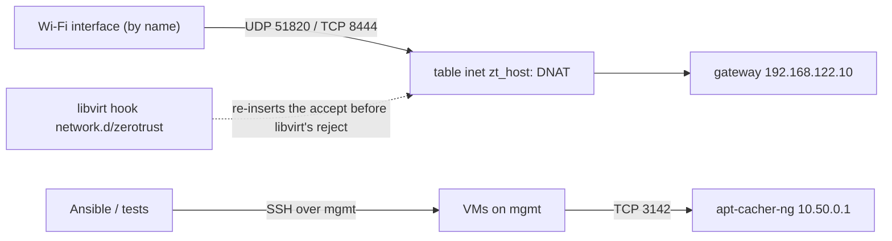

# Cloud host

## 1. Purpose

The cloud host is the laptop that runs the six VMs (KVM/libvirt) and the whole repository: it builds,
configures, tests and attacks everything. It also provides three small network services the VMs need:
the published ports (DNAT by interface name), an apt cache for VMs without internet, and the mDNS
name the remote client uses.

## 2. Responsibilities and non-responsibilities

**Responsibilities**

- run libvirt networks `zt-wan` (NAT), `zt-dmz`, `zt-app`, `zt-data`, `zt-mgmt` (isolated) and the VMs;
- publish UDP 51820 (WireGuard) and TCP 8444 (partner API) from its Wi-Fi interface to the gateway,
  matched by **interface name**, never by address;
- keep the libvirt hook that puts the WireGuard accept before libvirt's own reject rules;
- serve the apt cache (apt-cacher-ng) on 10.50.0.1:3142, reachable from mgmt only;
- announce `<hostname>.local` (avahi) on the Wi-Fi interface only;
- hold the generated secrets (`ansible/.secrets/`) and run Ansible, Terraform and the tests;
- host the bot's and the test peer's network namespaces (`zt-bot`, `zt-peer`).

**Non-responsibilities — it must NOT**

- have an address on dmz, app or data (it cannot reach the data planes);
- `flush ruleset` or default-drop its own traffic (it coexists with Docker and libvirt rules);
- appear in any certificate.

## 3. Where it runs

| Item | Value |
|---|---|
| Machine | the laptop itself (Ubuntu 22.04 or 24.04, ≥ 16 GB RAM recommended: the VMs use 7 GB) |
| Addresses | Wi-Fi (DHCP, never written in the repository) · `virbr-zt-wan` 192.168.122.1 · `virbr-zt-mgmt` 10.50.0.1 |
| systemd units | `zerotrust-host.service` (re-applies the table at boot), `libvirtd.service`, `apt-cacher-ng.service`, `avahi-daemon.service` |
| Files | `/etc/zerotrust/nftables-zt.conf` (table `inet zt_host`), `/etc/libvirt/hooks/network.d/zerotrust`, `/etc/sysctl.d/90-zerotrust.conf` |

## 4. Interfaces

| Direction | Peer | Protocol | Port | Authentication |
|---|---|---|---|---|
| in (Wi-Fi) | remote client | UDP (WireGuard) | `wan_port` (51820) → DNAT gateway | WireGuard keys at the gateway |
| in (Wi-Fi) | PayFlow / internet | TCP | 8444 → DNAT gateway | partner mTLS + HMAC at the frontend |
| out (mgmt) | every VM | SSH | 22 | key from `ssh_public_key_file` |
| in (mgmt) | every VM | HTTP | 3142 | none (apt verifies package signatures) |
| out (mgmt) | CA | via SSH | 22 | Ansible runs `step` commands on the CA |

## 5. Configuration

| Name | Default | Description |
|---|---|---|
| `entry_point` in `env.yaml` | `cloud-host.local` | the name the remote client dials (validated: never an IP) |
| `wan_interface` | `wlan0` (example) | the interface the DNAT is bound to — set yours (`ip -br link`) |
| `wan_port` | `51820` | published WireGuard port |
| `ssh_user`, `ssh_public_key_file` | `ubuntu`, `~/.ssh/id_ed25519.pub` | VM administration |
| `build/host/host.json`, `nftables-zt.conf`, `libvirt-hook` | generated | host rules |

See [`env.example.yaml`](../env.example.yaml) for every key and its comment.

## 6. Internals



## 7. Security

- **Identity**: none in the PKI; it is the administrator (SSH key) and holds every generated secret.
- **Hardening**: DNAT only by interface name; apt cache not exposed to the Wi-Fi; avahi on the Wi-Fi only;
  no route to the data planes.
- **If compromised**: everything is compromised (hypervisor, keys, SSH to every VM) — residual risk 2 in
  [THREAT-MODEL.md](THREAT-MODEL.md). The remote client's scan found the laptop's own services open to the
  Wi-Fi (listed in [evidence/remote-client-report.json](evidence/remote-client-report.json), check B1);
  none presents the bank's certificate.

## 8. Operations

```bash
make host                                   # install/repair, idempotent (asks for sudo once)
make test-1                                 # verify the host
sudo systemctl restart zerotrust-host       # re-apply DNAT after a network change
sudo nft list table inet zt_host
virsh -c qemu:///system list --all
python3 tools/infra-view.py nets            # networks, bridges, host addresses
make destroy && make up                     # rebuild every VM and network
```

Backup: `ansible/.secrets/` (keys and passwords) — copy it to encrypted storage; it is never in Git.

## 9. Failure modes and recovery

| Failure | Symptom | Detection | Recovery |
|---|---|---|---|
| Wi-Fi interface renamed or changed | no WireGuard handshake from outside | `make test-1` | update `wan_interface`, `make gen host` |
| libvirt restarted, hook not applied | DNAT'd packets rejected | `make test-1` | `sudo systemctl restart zerotrust-host` |
| mDNS blocked by the Wi-Fi | remote client cannot resolve `<hostname>.local` | `avahi-resolve` on the remote client | `/etc/hosts` line on the remote client |
| laptop reboot | VMs off, certificates may expire | `virsh list`; `make test-6` | `virsh start …` or `make up`; `make certs client-certs services` |
| apt cache down | VM package tasks fail | `systemctl status apt-cacher-ng` | restart it; rerun the stage |

## 10. Tests

| Tests | Command | Expected |
|---|---|---|
| [`tests/host/`](../tests/host/) | `make test-1` | pass: DNAT by interface name, no Wi-Fi address in the installed config, apt cache not on the Wi-Fi |
| [`tests/infra/`](../tests/infra/) | `make test-2` | pass: host address on mgmt and wan only, no route to the data planes |
| [`tests/unit/test_no_personal_data.py`](../tests/unit/test_no_personal_data.py) | `make test-0` | pass: no host-specific data in the repository |

## 11. Evidence

- Outside scan from the remote client: 65 535 TCP ports in 8 s, only the partner port presents the
  bank's certificate — [evidence/remote-client-report.json](evidence/remote-client-report.json) (B1).

## 12. Limitations

- Single point of failure and of trust — accepted for a one-laptop lab ([high-availability.md](high-availability.md)).
- Its own development services are reachable from the Wi-Fi — mitigation: bind them to 127.0.0.1 or
  add a host firewall; status: open, documented.

## 13. Related documents

[deployment.md](deployment.md) · [gateway.md](gateway.md) · [security.md](security.md) · [11-hote-reseaux-vm.md](11-hote-reseaux-vm.md) (FR)
