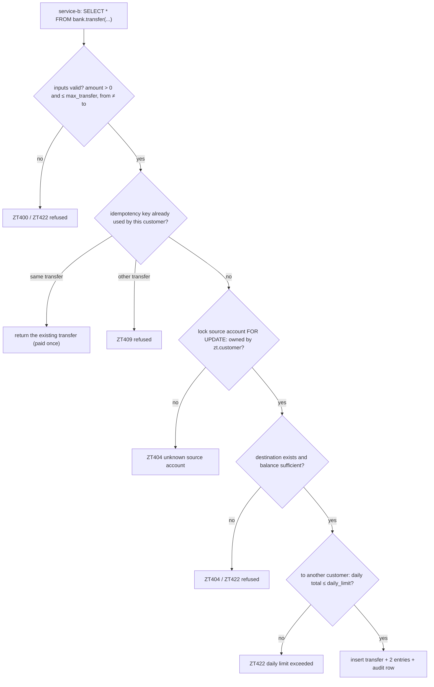

# Database

## 1. Purpose

The database holds the bank's state — customers, accounts, transfers, the double-entry ledger and the
audit trail — in PostgreSQL 16. It exists as the last line of defence: even a fully trusted caller can
only move money through functions that check ownership, limits, balance and idempotency, and can
never rewrite history.

## 2. Responsibilities and non-responsibilities

**Responsibilities**

- accept TLS 1.3 connections from service-b only, authenticated by client certificate (no password);
- enforce row-level security on customers, accounts, entries and transfers (`zt.customer`);
- move money only through `bank.transfer()` and `bank.incoming_payment()` (SECURITY DEFINER, locks,
  double entry, idempotency, per-transfer and daily limits, audit row);
- keep the ledger append-only (trigger refuses UPDATE, DELETE, TRUNCATE — even for the DBA);
- register partner nonces and references once (anti-replay).

**Non-responsibilities — it must NOT**

- listen on the mgmt network or accept password logins;
- grant the application role any INSERT/UPDATE/DELETE;
- consult the CRL (see Limitations).

## 3. Where it runs

| Item | Value |
|---|---|
| Host | VM `database`, 2048 MB |
| Interfaces | `data0` 10.40.0.10 · `mgmt0` 10.50.0.40 |
| Listener | 10.40.0.10:5432 only (`listen_addresses`) |
| systemd unit | `postgresql.service` (Ubuntu cluster wrapper), `zt-cert-renew.timer` |
| Files | `/etc/postgresql/<version>/main/conf.d/` (TLS, listen), `pg_hba.conf`, `pg_ident.conf` (generated), `/etc/zt/bank.sql` (rendered schema) |
| Database | `appdb`; owner role `bank_owner` (NOLOGIN); application role `service_b` |

## 4. Interfaces

| Direction | Peer | Protocol | Port | Authentication |
|---|---|---|---|---|
| in | service-b (10.40.0.11) | PostgreSQL, TLS 1.3 | 5432 | `hostssl appdb service_b 10.40.0.11/32 cert`; CN `service-b` mapped to `service_b` |
| out | CA | HTTPS | 9000 | certificate renewal |
| in | cloud host | SSH | 22 | SSH key, from 10.50.0.1 only |

## 5. Configuration

| Name | Default | Description |
|---|---|---|
| `services.postgres` in [`policy.yaml`](../policy.yaml) | `database`, `data`, 5432, `db_user: service_b`, `db_name: appdb` | listener and the only role |
| `ssl_min_protocol_version` | `TLSv1.3` | set by [`ansible/roles/postgres/tasks/main.yml`](../ansible/roles/postgres/tasks/main.yml) |
| `build/nodes/database/pg_hba.conf` | generated | one `hostssl … cert` line |
| `bank.max_transfer`, `bank.daily_limit` | `5000.00`, `2000.00` EUR | stored in `bank.settings` |
| `webhook.max_skew_seconds` | `300` | re-checked in `bank.incoming_payment()` |
| [`ansible/roles/postgres/files/seed.yaml`](../ansible/roles/postgres/files/seed.yaml) | fictional customers | demo data |

## 6. Internals

Schema in [`bank.sql.j2`](../ansible/roles/postgres/templates/bank.sql.j2): tables `settings`,
`customers`, `accounts`, `transfers`, `entries`, `audit`, `partners`, `partner_nonces`, `incoming`;
functions `transfer`, `incoming_payment`, `statements`, `status`; trigger `append_only`; row-level
security on customers, accounts, entries, transfers. Grants: `SELECT` on four tables and `EXECUTE`
on four functions for `service_b`; nothing on `audit`.



## 7. Security

- **Identity**: certificate `CN=database`, `spiffe://cloud.local/database`, key generated on the VM,
  readable by `postgres` through group `zt-tls`.
- **Permissions**: the application role cannot write any table, cannot read `audit`; functions run as
  `bank_owner` (NOLOGIN).
- **Hardening**: data-plane listener only, TLS 1.3 only, certificate authentication, no `PUBLIC` rights.
- **If compromised** (root on the VM): full access to the bank's data — this is the crown jewel; the
  firewall still prevents it from reaching any other VM.

## 8. Operations

```bash
make services                                                         # idempotent: schema re-applied safely
ssh -F build/ssh_config database sudo systemctl status postgresql --no-pager
ssh -F build/ssh_config database "sudo journalctl -u 'postgresql*' -n 50 --no-pager"
ssh -F build/ssh_config database "sudo -u postgres psql -d appdb -c 'SELECT bank.status()'"
ssh -F build/ssh_config database "sudo -u postgres psql -d appdb -tAc 'SELECT sum(amount_cents) FROM bank.entries'"   # must be 0
# backup (to the cloud host):
ssh -F build/ssh_config database "sudo -u postgres pg_dump -Fc appdb" > build/appdb-$(date +%F).dump
```

## 9. Failure modes and recovery

| Failure | Symptom | Detection | Recovery |
|---|---|---|---|
| PostgreSQL down | 5xx on every bank call | `systemctl status postgresql`; `make test-7` | `sudo systemctl restart postgresql` |
| server certificate expired | service-b handshake fails | `make test-6` | `make certs services` |
| ledger not balanced | `make audit` finding | audit "Ledger" line | restore from the last `pg_dump`; investigate the audit table |
| disk full | write errors | `df -h` on the VM | grow the disk (Terraform), vacuum |

## 10. Tests

| Tests | Command | Expected |
|---|---|---|
| [`tests/unit/test_bank_sql.py`](../tests/unit/test_bank_sql.py) | `make test-0` (needs a local PostgreSQL, else skipped) | pass |
| [`tests/bank/`](../tests/bank/) | `make test-10` | pass: RLS in the real database, role cannot write, history append-only even for the DBA |
| [`tests/services/test_services.py`](../tests/services/test_services.py) | `make test-7` | pass: refuses no certificate, plaintext, other identity |
| [`tests/final/test_confidentiality.py`](../tests/final/test_confidentiality.py) | `make test-8` | pass: TLS 1.3 on the data hop, TLS 1.2 refused |

## 11. Evidence

- Ledger balance check and the bank's own audit trail: [evidence/audit.md](evidence/audit.md) ("The bank's own audit trail").
- Database reachable only from service-b: [evidence/drift-summary.md](evidence/drift-summary.md).

## 12. Limitations

- PostgreSQL does not check the CRL; its only client is pinned by address and identity — status:
  documented in [THREAT-MODEL.md](THREAT-MODEL.md).
- No replica, no automated backup — see [high-availability.md](high-availability.md); mitigation: `pg_dump` above.

## 13. Related documents

[service-b.md](service-b.md) · [architecture.md](architecture.md) · [security.md](security.md) · [16-zt-bank.md](16-zt-bank.md) (FR)
