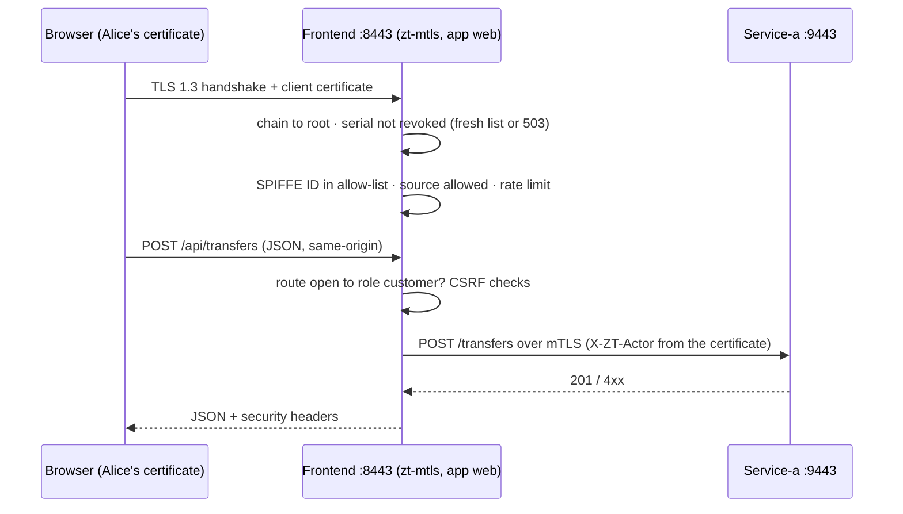

# Frontend

## 1. Purpose

The frontend is the only service that people and partners talk to: it serves the bank's website and
API to tunnel clients on :8443 and the partner webhook on :8444, both over mutual TLS. It exists to
turn a verified client certificate into an identity and a role, enforce the edge rules (routes, CSRF,
rate limits, revocation) and forward only allowed requests to service-a.

## 2. Responsibilities and non-responsibilities

**Responsibilities**

- TLS 1.3 server with mandatory client certificates from the internal CA;
- refuse revoked serials, and refuse everyone when the revocation list is missing or stale (fail-closed);
- check the caller's SPIFFE identity against the listener's allow-list and its source address
  (device binding for the bot);
- apply per-identity rate limits (token bucket, 429 + `Retry-After`);
- apply per-role routes (404 unknown route, 403 route not open to the role);
- refuse cross-site and non-JSON POSTs (403 / 415);
- verify the partner's HMAC signature and time window before forwarding a payment;
- call service-a over mTLS, pinning service-a's address and SPIFFE identity;
- serve the static website (`/`, `/static/*`).

**Non-responsibilities — it must NOT**

- read identity from request headers sent by clients (they are ignored);
- talk to service-b or the database (blocked by its firewall and by their allow-lists);
- hold any key other than its own and the partner HMAC secret;
- make business decisions on money (service-a and the database re-check everything).

## 3. Where it runs

| Item | Value |
|---|---|
| Host | VM `frontend`, 1024 MB |
| Interfaces | `dmz0` 10.20.0.10 · `app0` 10.30.0.10 · `mgmt0` 10.50.0.20 |
| Listeners | `https` 10.20.0.10:8443 (app `web`) · `partner-api` 10.20.0.10:8444 (app `partner`) |
| Route | 10.10.0.0/24 via 10.20.0.1 (replies to the tunnel) |
| systemd units | `zt-mtls.service` (user `zt-app`), `zt-crl.timer`, `zt-cert-renew.timer` |
| Files | `/usr/local/bin/zt-mtls`, `/usr/local/lib/zt/zt_bank.py`, `/usr/local/share/zt-bank/www/`, `/etc/zt/mtls.json`, `/etc/zt/pki/`, `/etc/zt/partners/payflow.key` |

## 4. Interfaces

| Direction | Peer | Protocol | Port | Authentication |
|---|---|---|---|---|
| in | tunnel actors (alice, bob, dev, statements) | HTTPS, TLS 1.3 | 8443 | client certificate, SPIFFE allow-list, source check, role routes |
| in | PayFlow via gateway SNAT (source 10.20.0.1) | HTTPS, TLS 1.3 | 8444 | partner certificate + `X-ZT-Signature` HMAC-SHA256, ±300 s, nonce |
| out | service-a | HTTPS, TLS 1.3 | 9443 | own certificate (`spiffe://cloud.local/frontend`); server pinned by IP and SPIFFE ID |
| out | CA | HTTPS | 9000 | CRL download (`zt-crl`), certificate renewal (`zt-cert-renew`) |
| in | cloud host | SSH | 22 | SSH key, from 10.50.0.1 only |

## 5. Configuration

| Name | Default | Description |
|---|---|---|
| `/etc/zt/mtls.json` | generated from [`policy.yaml`](../policy.yaml) (`build/nodes/frontend/mtls.json`) | identity, listeners, allow-lists, allowed sources, routes, next hop, actors, rate limits, revocation file |
| `services.https`, `services.partner-api` | 8443, 8444 on dmz | listeners |
| `routes.https`, `routes.partner-api` | see policy | method + path + allowed roles |
| `roles.<role>.rate_limit` | customer/staff `240/min`, bot `20/min`, partner `60/min` | token bucket per identity |
| `actors.<a>.device` | `statements: device: bot` | binds an identity to a WireGuard peer address |
| `webhook.max_skew_seconds` | `300` | partner timestamp window |
| `/etc/zt/partners/payflow.key` | generated in `ansible/.secrets/partners/` | partner HMAC secret, root:zt-app 0640 |
| `cert.lifetime`, `cert.renew_before` | `24h`, `8h` | certificate lifetime and renewal threshold |

## 6. Internals

- [`ansible/roles/app/files/zt-mtls`](../ansible/roles/app/files/zt-mtls): Python standard-library TLS server
  and client; `Revocation`, `RateLimiter`, route matching, next-hop pinning, security headers;
- [`ansible/roles/app/files/zt_bank.py`](../ansible/roles/app/files/zt_bank.py): `web` (API + CSRF),
  `partner` (signature, window) application handlers;
- [`ansible/roles/app/files/www/`](../ansible/roles/app/files/www/): `index.html`, `app.js`, `app.css`,
  `logo.svg` — no inline code, text-only rendering.



## 7. Security

- **Identity**: `spiffe://cloud.local/frontend`, 24 h certificate, key generated on the VM.
- **Permissions**: user `zt-app` (no shell, no capabilities), group `zt-tls` to read the key;
  systemd `ProtectSystem=strict`, `NoNewPrivileges`, empty `CapabilityBoundingSet`,
  `MemoryDenyWriteExecute`, `RestrictAddressFamilies=AF_INET AF_UNIX`
  ([unit template](../ansible/roles/app/templates/zt-mtls.service.j2)).
- **Hardening**: CSP `default-src 'self'`, HSTS, COOP, CORP, `Permissions-Policy`; JSON-only POST;
  identity headers from clients ignored; tracebacks never returned (500 "internal error").
- **If compromised**: root on the frontend can call service-a as any customer within the customer
  routes and limits (residual risk, [THREAT-MODEL.md](THREAT-MODEL.md)). It cannot reach service-b
  or the database, mint certificates, or read other keys (attack A2 in
  [`tests/attacks/catalogue.yaml`](../tests/attacks/catalogue.yaml)).

## 8. Operations

```bash
make services                                                     # (re)deploy, idempotent
ssh -F build/ssh_config frontend sudo systemctl status zt-mtls --no-pager
ssh -F build/ssh_config frontend "sudo journalctl -u zt-mtls -n 50 --no-pager"
ssh -F build/ssh_config frontend "sudo journalctl -u zt-mtls --no-pager | grep -E 'refused|denied'"
ssh -F build/ssh_config frontend sudo systemctl restart zt-mtls
ssh -F build/ssh_config frontend "sudo cat /etc/zt/pki/revoked.json"        # CRL in force
make test-7                                                       # health: the full chain answers
```

Upgrade: change the code in [`ansible/roles/app/files/`](../ansible/roles/app/files/), then `make services`.
Backup: none needed; all state is in the database and all configuration is generated.

## 9. Failure modes and recovery

| Failure | Symptom | Detection | Recovery |
|---|---|---|---|
| revocation list missing or stale | every request 503 "revocation status unknown" | `make audit` (finding), `journalctl -u zt-mtls` | `sudo systemctl start zt-crl`; check the CA ([ca.md](ca.md)) |
| certificate expired (VM off > 24 h) | service-a refuses the frontend; clients get 502 | `make test-6` | `make certs services` |
| client certificate revoked or expired | 403 "… is revoked" / handshake failure | browser error; audit "Refusals" | `make client-certs`, re-import in Firefox |
| service-a unreachable or revoked | 502 "next hop unavailable" | `journalctl -u zt-mtls` | fix service-a ([service-a.md](service-a.md)) |
| rate limit reached | 429 + `Retry-After` | audit "rate-limited" rows | wait; adjust `roles.<role>.rate_limit` |
| process crash | connection refused on 8443 | `systemctl status zt-mtls` | systemd restarts it (`Restart=on-failure`) |

## 10. Tests

| Tests | Command | Expected |
|---|---|---|
| [`tests/unit/test_zt_mtls.py`](../tests/unit/test_zt_mtls.py), [`test_web_ui.py`](../tests/unit/test_web_ui.py), [`test_revocation.py`](../tests/unit/test_revocation.py), [`test_partner.py`](../tests/unit/test_partner.py) | `make test-0` | pass offline (real `zt-mtls` processes on 127.0.0.x) |
| [`tests/services/`](../tests/services/) | `make test-7` | all pass: refusals (no cert, foreign CA, expired, wrong identity, TLS 1.2) |
| [`tests/actors/`](../tests/actors/), [`tests/web/`](../tests/web/), [`tests/edge/`](../tests/edge/) | `make test-9 test-11 test-12` | all pass |
| attacks A1, A4, A7, A8, A9, A10 | `make attack A=1,4,7,8,9,10` | DEFENDED |

## 11. Evidence

- Requests per identity and every refusal with its reason, over 24 h:
  [evidence/audit.md](evidence/audit.md) (e.g. 376 requests by `customer/alice`, 268 by `bot/statements`).
- Remote client checks B2 (forged identities), B4 (overstepping), B5 (forged payments), B6 (revocation):
  DEFENDED — [evidence/remote-client-report.json](evidence/remote-client-report.json).
- Request latency: TODO[measure]: time 100 `GET /api/accounts` calls from the test peer with
  `tests/tls_probe.py` and record p50/p95.

## 12. Limitations

- Speaks for customers to service-a: a compromised frontend can act as any customer — mitigation
  proposed (end-to-end signed requests), status: documented residual risk.
- One instance, no load balancing — see [high-availability.md](high-availability.md).
- Python standard-library HTTP server: suitable for the lab load only — TODO[measure]: load test.

## 13. Related documents

[architecture.md](architecture.md) · [service-a.md](service-a.md) · [revocation.md](revocation.md) ·
[payflow-partner.md](payflow-partner.md) · [statements-bot.md](statements-bot.md) · [security.md](security.md) ·
[16-zt-bank.md](16-zt-bank.md) (FR) · [17-site-web.md](17-site-web.md) (FR)
