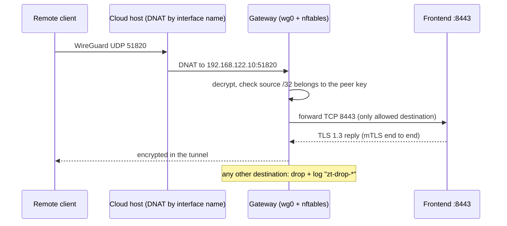

# Gateway

## 1. Purpose

The gateway is the only virtual machine that routes: it terminates the WireGuard tunnel used by
remote clients and the bot, and forwards the partner port from the cloud host to the frontend.
It exists so that exactly one, small, rule-driven component decides what may enter the cloud.

## 2. Responsibilities and non-responsibilities

**Responsibilities**

- terminate WireGuard (`wg0`, 10.10.0.1/24) with one key and one pre-shared key per peer;
- forward tunnel traffic to `frontend:8443` only, and nothing else;
- forward the published partner port (TCP 8444) from the cloud host to `frontend:8444`, with DNAT
  and SNAT so the frontend sees the gateway's dmz address as the partner's source;
- limit new connections per peer where the policy says so (the bot: `conn_limit: 5/second`);
- drop and log everything else, silently (no RST, no ICMP).

**Non-responsibilities — it must NOT**

- terminate TLS or inspect HTTP: authentication of users and services is end to end (mTLS);
- translate tunnel source addresses: the frontend must see the real tunnel address of each peer;
- reach the app, data or mgmt business ports, or accept SSH from anything but the cloud host;
- hold any certificate or application secret.

## 3. Where it runs

| Item | Value |
|---|---|
| Host | VM `gateway` (KVM on the cloud host), 1024 MB, see [`terraform/vms.tf`](../terraform/vms.tf) |
| Interfaces | `wan0` 192.168.122.10 (zt-wan, NAT) · `dmz0` 10.20.0.1 · `mgmt0` 10.50.0.2 · `wg0` 10.10.0.1 |
| Listening ports | UDP 51820 on `wan0` (WireGuard); TCP 22 on `mgmt0` from 10.50.0.1 only |
| systemd units | `wg-quick@wg0.service`, `nftables.service` |
| Configuration | `/etc/wireguard/wg0.conf` (0600), `/etc/nftables.conf` (generated) |
| Routing | default route via 192.168.122.1 (`default_gateway` in [`policy.yaml`](../policy.yaml)); `ip_forward: true` |

## 4. Interfaces

| Direction | Peer | Protocol | Port | Authentication |
|---|---|---|---|---|
| in | remote client (via cloud host DNAT) | WireGuard / UDP | 51820 | peer public key + per-peer pre-shared key |
| in | bot (network namespace `zt-bot` on the cloud host) | WireGuard / UDP | 51820 | peer key + PSK; then ≤ 5 new connections/s |
| in | test peer `zt-peer` (hostile client for tests) | WireGuard / UDP | 51820 | peer key + PSK |
| forward | tunnel peers → frontend | TCP | 8443 | none at this layer; mTLS end to end at the frontend |
| forward | internet (cloud host DNAT) → frontend | TCP | 8444 | none at this layer; partner mTLS + HMAC at the frontend |
| in | cloud host | SSH | 22 | SSH key from `env.yaml`, from 10.50.0.1 only |
| out | CA | HTTPS | 9000 | (enrolment not used by the gateway; flow allowed by `infra: pki`) |
| out | cloud host apt cache | HTTP | 3142 | none (package signatures checked by apt) |

## 5. Configuration

| Name | Default | Description |
|---|---|---|
| `services.wireguard` in [`policy.yaml`](../policy.yaml) | `gateway`, `wan`, UDP 51820 | where WireGuard listens |
| `networks.tunnel.cidr` | `10.10.0.0/24` | tunnel addresses; each peer owns a /32 |
| `wireguard.peers` | `remote-client` 10.10.0.2, `bot` 10.10.0.3, `test-peer` 10.10.0.200 | peers, `netns`, `conn_limit`, `test` flag |
| `flows` (`client-frontend`, `partner-webhook`, `wg-ingress`) | see policy | what the forward chain allows |
| `wan_port` in `env.yaml` | `51820` | UDP port the cloud host publishes and DNATs to the gateway |
| `entry_point` in `env.yaml` | `cloud-host.local` | name written into the remote client's `Endpoint=` (never an IP) |
| `ansible/.secrets/wireguard/` | generated once | private keys, public keys, PSKs (never committed) |
| `build/nodes/gateway/nftables.conf` | generated | ruleset installed as `/etc/nftables.conf` |

## 6. Internals

- [`ansible/roles/wireguard/`](../ansible/roles/wireguard/) renders `wg0.conf` from the generated
  templates and the keys of [`ansible/tasks/wg_keys.yml`](../ansible/tasks/wg_keys.yml);
- [`ansible/roles/nftables/`](../ansible/roles/nftables/) installs the generated ruleset with
  `/usr/local/sbin/zt-nft-apply`, which keeps the previous ruleset and rolls back after 120 s unless
  Ansible confirms over a new SSH connection;
- the ruleset is one table `inet zt` with input/output/forward chains (policy drop) and NAT
  prerouting/postrouting chains for the partner port.



## 7. Security

- **Identity**: WireGuard keys; no X.509 identity, no application secret.
- **Permissions**: root runs `wg-quick` and nftables (kernel features); no application service.
- **Hardening**: default-drop on every chain; denials silent and rate-limited logged; cryptokey routing
  (a peer can only use its own /32); per-peer connection limit for the bot; SSH from the cloud host only.
- **If compromised**: the attacker can see tunnel traffic only as TLS 1.3 ciphertext, can reach the
  frontend's two listeners (which still require client certificates), and can drop traffic (denial of
  service). It cannot impersonate a user or a service (no keys), and the frontend's own firewall still
  limits it to 8443/8444. See [THREAT-MODEL.md](THREAT-MODEL.md).

## 8. Operations

```bash
make wireguard                                        # (re)deploy keys and wg0.conf (idempotent)
make firewall                                         # (re)deploy nftables with automatic rollback
ssh -F build/ssh_config gateway sudo wg show wg0 latest-handshakes
ssh -F build/ssh_config gateway sudo nft list ruleset
ssh -F build/ssh_config gateway "sudo journalctl -k -n 50 --no-pager | grep zt-drop"
ssh -F build/ssh_config gateway sudo systemctl restart wg-quick@wg0
python3 tools/infra-view.py wg                        # peers, last handshake, bytes (keys hidden)
```

Upgrade: `ssh -F build/ssh_config gateway sudo apt-get update && sudo apt-get -y upgrade` (packages
come from the cloud host's apt cache). Backup: nothing to back up on the VM; the keys live in
`ansible/.secrets/wireguard/` on the cloud host.

## 9. Failure modes and recovery

| Failure | Symptom | Detection | Recovery |
|---|---|---|---|
| `wg-quick@wg0` stopped | remote client: no handshake | `sudo wg show` empty; `tests/wireguard` fail | `sudo systemctl restart wg-quick@wg0` or `make wireguard` |
| cloud host DNAT missing (after reboot, libvirt restart) | no handshake from outside | `make test-1` (DNAT tests) | `sudo systemctl restart zerotrust-host` or `make host` |
| ruleset change cuts SSH | Ansible loses the VM | `zt-nft-apply` rollback after 120 s | wait; fix policy; `make firewall` |
| peer key rotated on one side only | handshake never completes | `latest-handshakes` = 0 | `make wireguard`, re-export `build/export/<peer>/wg0.conf` |
| VM down | everything from the tunnel and the partner fails closed | `virsh list`, `infra-view.py map` | `virsh start gateway` |

## 10. Tests

| Tests | Command | Expected |
|---|---|---|
| [`tests/wireguard/`](../tests/wireguard/) | `make test-5` | all pass: only `frontend:8443` reachable from the tunnel, spoofed /32 dropped, unknown key and key without PSK get no answer |
| [`tests/firewall/`](../tests/firewall/) | `make test-4` | all pass: live ruleset equals the generated one; matrix probes match the policy |
| [`tests/attacks/test_attacks.py`](../tests/attacks/test_attacks.py) (A5 scans) | `make attack A=5` | DEFENDED |
| [`tests/unit/test_generated.py`](../tests/unit/test_generated.py) | `make test-0` | pass offline: only the gateway forwards, only tunnel → frontend:8443 |

## 11. Evidence

- Live N×N probe of the policy matrix: 194 probes, 21 allowed flows reached, 0 deviations —
  [evidence/drift-summary.md](evidence/drift-summary.md), raw [evidence/drift-report.json](evidence/drift-report.json).
- From the remote client, every bank network routed into the tunnel: all 13 internal targets silent,
  spoofed address silent (check B3) — [evidence/remote-client-report.json](evidence/remote-client-report.json).
- Handshake latency, throughput: TODO[measure]: `iperf3` through the tunnel from the remote client to
  a test listener on the frontend (requires a temporary policy flow).

## 12. Limitations

- Single gateway, no failover — see [high-availability.md](high-availability.md); status: accepted for a single-laptop lab.
- Not post-quantum (X25519); the per-peer PSK adds a symmetric layer — status: documented in [THREAT-MODEL.md](THREAT-MODEL.md).
- Denial of service on the Wi-Fi link is not mitigated — status: out of scope.

## 13. Related documents

[architecture.md](architecture.md) · [cloud-host.md](cloud-host.md) · [frontend.md](frontend.md) ·
[security.md](security.md) · [testing.md](testing.md) · [14-wireguard.md](14-wireguard.md) (FR) · [13-pare-feu.md](13-pare-feu.md) (FR)
