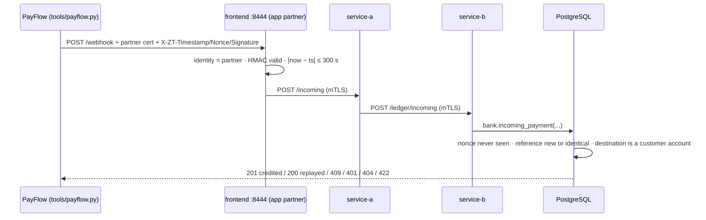

# PayFlow partner (payment webhook)

## 1. Purpose

PayFlow is a simulated payment provider on the internet that notifies the bank of incoming payments
without any VPN. It exists to show a second, narrow front door: one published port, a partner
certificate, and signed, time-boxed, single-use requests.

## 2. Responsibilities and non-responsibilities

**Responsibilities** (of the client [`tools/payflow.py`](../tools/payflow.py) and the bank's partner API)

- send `POST /webhook` to the published port with the partner certificate;
- sign `timestamp.nonce.body` with HMAC-SHA256 (`X-ZT-Timestamp`, `X-ZT-Nonce`, `X-ZT-Signature: v1=<hex>`);
- on the bank side: verify identity, signature and ±300 s window at the frontend; register the nonce
  and the payment reference once in the database; credit the customer in double entry from the
  partner's settlement account, audited with the partner's SPIFFE identity.

**Non-responsibilities — the partner must NOT**

- reach anything but `POST /webhook` (all other routes: 404/403);
- use the tunnel (its identity is refused there);
- pay twice: a replayed request is refused (409), a retry with a new nonce is answered without paying again.

## 3. Where it runs

| Item | Value |
|---|---|
| Client | anywhere outside; in this lab, the cloud host's own namespace (`make pay`) |
| Bank side | frontend `partner-api` 10.20.0.10:8444, reached through cloud host DNAT → gateway DNAT + SNAT |
| Identity | `spiffe://cloud.local/partner/payflow` (certificate in `ansible/.secrets/pki/partner-payflow/`) |
| Secret | `ansible/.secrets/partners/payflow.key` (cloud host), `/etc/zt/partners/payflow.key` (frontend, root:zt-app 0640) |

## 4. Interfaces

| Direction | Peer | Protocol | Port | Authentication |
|---|---|---|---|---|
| out | cloud host Wi-Fi → gateway → frontend | HTTPS, TLS 1.3 | 8444 | partner client certificate + HMAC-SHA256 signature, ±300 s, single-use nonce |

## 5. Configuration

| Name | Default | Description |
|---|---|---|
| `services.partner-api` in [`policy.yaml`](../policy.yaml) | `frontend`, `dmz`, 8444, `app: partner` | listener |
| `flows.partner-webhook` | from `internet` | the only internet-facing flow besides WireGuard |
| `actors.payflow` | `role: partner, entry: internet` | identity |
| `roles.partner.rate_limit` | `60/min` | token bucket |
| `webhook.max_skew_seconds` | `300` | timestamp window |
| `routes.partner-api` | `POST /webhook` (partner) | the only route |

## 6. Internals



## 7. Security

- **If the partner secret leaks**: an attacker still needs the partner's certificate and key; nonces and
  references stop replays; rotate by deleting the key file and running `make services`.
- **If the partner certificate leaks**: `make revoke ACTOR=payflow`.

## 8. Operations

```bash
make pay TO=ZTB-ALICE-01 AMOUNT=10.00
.venv/bin/python tools/payflow.py --to ZTB-ALICE-01 --amount 1.00 --replay        # replay → refused
.venv/bin/python tools/payflow.py --to ZTB-ALICE-01 --amount 1.00 --tamper        # body changed → 401
.venv/bin/python tools/payflow.py --to ZTB-ALICE-01 --amount 1.00 --skew -900     # outside the window → 401
.venv/bin/python tools/payflow.py --to ZTB-ALICE-01 --amount 1.00 --wrong-secret  # → 401
```

## 9. Failure modes and recovery

| Failure | Symptom | Detection | Recovery |
|---|---|---|---|
| clock skew > 300 s | 401 on every call | response body | fix time sync |
| partner certificate expired | handshake refused | client error | `make client-certs` |
| port 8444 not published | connection timeout | `make test-1`, `make test-12` | `sudo systemctl restart zerotrust-host` |

## 10. Tests

| Tests | Command | Expected |
|---|---|---|
| [`tests/unit/test_partner.py`](../tests/unit/test_partner.py) | `make test-0` | pass: signature, window, replay, idempotent reference, refusals |
| [`tests/edge/test_edge.py`](../tests/edge/test_edge.py) | `make test-12` | pass: payment from outside, replay refused, retry not repaid, partner limited to the webhook, refused in the tunnel |
| attack A9 | `make attack A=9` | DEFENDED |

## 11. Evidence

- 69 requests by `spiffe://cloud.local/partner/payflow` in 24 h: [evidence/audit.md](evidence/audit.md).
- Remote check B5 (forged notifications from the Wi-Fi, balance unchanged): DEFENDED —
  [evidence/remote-client-report.json](evidence/remote-client-report.json).

## 12. Limitations

- One shared HMAC secret per partner, no automated rotation — status: manual rotation documented above.

## 13. Related documents

[frontend.md](frontend.md) · [database.md](database.md) · [cloud-host.md](cloud-host.md) · [18-bot-et-partenaire.md](18-bot-et-partenaire.md) (FR)
