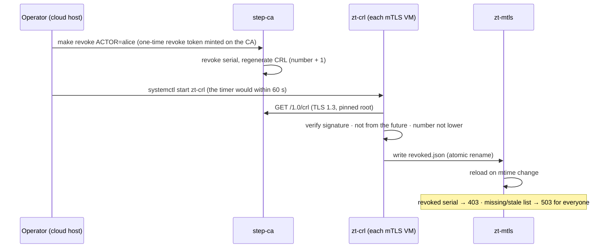

# Revocation (zt-crl)

## 1. Purpose

`zt-crl` brings the CA's certificate revocation list to every mTLS service and turns it into a list
of revoked serials that `zt-mtls` enforces without a restart. It exists because OpenSSL's built-in CRL
check rejects step-ca's CRL ("different CRL scope": the CRL has an Issuing Distribution Point, our
certificates have no CRL Distribution Point).

## 2. Responsibilities and non-responsibilities

**Responsibilities**

- download `https://10.50.0.10:9000/1.0/crl` over TLS 1.3, pinned to the internal root, never through a proxy;
- verify the CRL signature against the CA chain; refuse a CRL issued in the future and a CRL number
  lower than the last one (rollback);
- write `/etc/zt/pki/revoked.json` atomically (serials, CRL number, this/next update, fetch time);
- run every minute, and at once when `make revoke` asks.

**Non-responsibilities — it must NOT**

- decide policy: `zt-mtls` refuses revoked serials, and refuses everyone when the list is missing,
  unreadable or past its next update (fail-closed);
- write anywhere but `/etc/zt/pki`.

## 3. Where it runs

| Item | Value |
|---|---|
| Hosts | every VM with an HTTPS mTLS listener: `frontend`, `service-a`, `service-b` |
| Program | `/usr/local/sbin/zt-crl` ([source](../ansible/roles/app/files/zt-crl)) |
| systemd units | `zt-crl.service` (oneshot, root) and `zt-crl.timer` (`OnBootSec=10s`, `OnUnitActiveSec=60s`) |
| Output | `/etc/zt/pki/revoked.json` (0644) |
| Network | mgmt → CA 10.50.0.10:9000 (`infra: pki`) |

## 4. Interfaces

| Direction | Peer | Protocol | Port | Authentication |
|---|---|---|---|---|
| out | CA `/1.0/crl` | HTTPS, TLS 1.3 | 9000 | server verified against the pinned root; CRL signature verified with `openssl crl -CAfile` |
| local | `zt-mtls` | file `/etc/zt/pki/revoked.json` | — | file ownership root, read by `zt-app` |

## 5. Configuration

| Name | Default | Description |
|---|---|---|
| `revocation.crl_url` in `/etc/zt/mtls.json` | `https://10.50.0.10:9000/1.0/crl` | generated from `services.step-ca` |
| `revocation.file` | `/etc/zt/pki/revoked.json` | where the list is published |
| `ZT_PKI` (environment) | `/etc/zt/pki` | directory with `root_ca.crt` and `cert.crt` |
| timer period | 60 s | [`zt-crl.timer.j2`](../ansible/roles/app/templates/zt-crl.timer.j2) |
| `crl.cacheDuration` on the CA | `24h0m0s` | next-update horizon; after it the list is stale → 503 |

## 6. Internals



## 7. Security

- **Identity**: none of its own; trusts the pinned root only.
- **Permissions**: root, `ProtectSystem=strict`, `ReadWritePaths=/etc/zt/pki`, `NoNewPrivileges`,
  `RestrictAddressFamilies=AF_INET AF_UNIX` ([unit template](../ansible/roles/app/templates/zt-crl.service.j2)).
- **If compromised** (or the CA blocked): an attacker can make the list stale — the result is denial of
  service (503 for everyone), never acceptance of a revoked certificate.

## 8. Operations

```bash
ssh -F build/ssh_config frontend sudo systemctl start zt-crl            # refresh now
ssh -F build/ssh_config frontend "sudo journalctl -u zt-crl -n 20 --no-pager"
ssh -F build/ssh_config frontend "sudo cat /etc/zt/pki/revoked.json"
ssh -F build/ssh_config frontend systemctl list-timers zt-crl.timer --no-pager
make revoke ACTOR=alice REASON="stolen laptop" && make client-certs
make audit                                                              # CRL number and age per service
```

## 9. Failure modes and recovery

| Failure | Symptom | Detection | Recovery |
|---|---|---|---|
| CA unreachable < 24 h | list not refreshed, still valid | `make audit` warns when fetched > 180 s ago | fix the CA; nothing else to do |
| CA unreachable > next update | 503 for every request | audit finding "STALE" | restore the CA, `systemctl start zt-crl` |
| CRL with a lower number | fetch refused, old list kept | `journalctl -u zt-crl` | investigate (rollback attempt or CA rebuilt) |
| services enforce different lists | — | audit finding "different CRLs" | `systemctl start zt-crl` on each VM |

## 10. Tests

| Tests | Command | Expected |
|---|---|---|
| [`tests/unit/test_revocation.py`](../tests/unit/test_revocation.py) | `make test-0` | pass: real CRL, signature, rollback, other signer, fail-closed, revoked upstream → 502 |
| [`tests/unit/test_revocation_deploy.py`](../tests/unit/test_revocation_deploy.py) | `make test-0` | pass: deployed on every HTTPS service, before the service starts |
| A1 in [`tests/attacks/test_attacks.py`](../tests/attacks/test_attacks.py) | `make test-13` | pass: a revoked copy is refused on every service within the 90 s deadline, without restart |

## 11. Evidence

- 13 requests refused with "certificate … is revoked" in 24 h, from the remote client's revoked copy:
  [evidence/audit.md](evidence/audit.md) ("Refusals", "Revocation").
- Remote check B6, the stolen-laptop drill from the second machine: DEFENDED —
  [evidence/remote-client-report.json](evidence/remote-client-report.json).
- Exact revocation-to-refusal latency: TODO[measure]: run `pytest -s tests/attacks -k revoked_within`,
  which prints the seconds between the revocation and the first refusal.

## 12. Limitations

- Latency up to the timer period (60 s) when not triggered by `make revoke`.
- PostgreSQL does not use the list (its only client is pinned) — see [database.md](database.md).

## 13. Related documents

[ca.md](ca.md) · [frontend.md](frontend.md) · [security.md](security.md) · [18b-attaques-revocation-audit.md](18b-attaques-revocation-audit.md) (FR)
