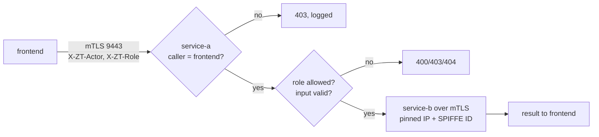

# Service-a (core)

## 1. Purpose

Service-a runs the bank's business rules ("core"): it receives already-authenticated requests from
the frontend, re-checks the caller's role and the limits, and asks the ledger to act. It exists so
that the business rules live behind a second, independent identity check and never next to the
database.

## 2. Responsibilities and non-responsibilities

**Responsibilities**

- accept mTLS connections from the frontend only, on its own routes only;
- re-check the actor's role for each operation (defence in depth);
- validate requests (account ids, amounts, idempotency keys, statement months);
- call service-b over mTLS, pinning its address and identity, and refuse a revoked service-b.

**Non-responsibilities — it must NOT**

- accept requests from anyone but the frontend (allow-list + firewall);
- connect to PostgreSQL (only service-b may);
- trust identity headers from anyone but the frontend;
- store state: it is stateless.

## 3. Where it runs

| Item | Value |
|---|---|
| Host | VM `service-a`, 1024 MB |
| Interfaces | `app0` 10.30.0.11 · `mgmt0` 10.50.0.30 |
| Listener | `api-a` 10.30.0.11:9443 (app `core`) |
| systemd units | `zt-mtls.service` (user `zt-app`), `zt-crl.timer`, `zt-cert-renew.timer` |
| Files | `/usr/local/bin/zt-mtls`, `/usr/local/lib/zt/zt_bank.py`, `/etc/zt/mtls.json`, `/etc/zt/pki/` |

## 4. Interfaces

| Direction | Peer | Protocol | Port | Authentication |
|---|---|---|---|---|
| in | frontend (10.30.0.10) | HTTPS, TLS 1.3 | 9443 | client certificate `spiffe://cloud.local/frontend`, source address, routes |
| out | service-b (10.30.0.12) | HTTPS, TLS 1.3 | 9443 | own certificate `spiffe://cloud.local/service-a`; server pinned |
| out | CA | HTTPS | 9000 | CRL download, renewal |
| in | cloud host | SSH | 22 | SSH key, from 10.50.0.1 only |

Routes (from [`policy.yaml`](../policy.yaml), all allowed to `frontend` only): `GET /accounts`,
`GET /accounts/*/transactions`, `POST /transfers`, `GET /statements`, `GET /status`, `GET /health`,
`GET /chain`, `POST /incoming`.

## 5. Configuration

| Name | Default | Description |
|---|---|---|
| `/etc/zt/mtls.json` | generated (`build/nodes/service-a/mtls.json`) | identity, `api-a` listener, allowed caller and source, routes, next hop service-b |
| `services.api-a` | `service-a`, `app`, 9443 | listener |
| `routes.api-a` | see above | allowed routes |
| `bank.max_transfer` | `"5000.00"` | per-transfer limit (also enforced in the database) |
| `bank.daily_limit` | `"2000.00"` | per-customer daily limit (enforced in the database) |

## 6. Internals

The `core` handler in [`ansible/roles/app/files/zt_bank.py`](../ansible/roles/app/files/zt_bank.py)
maps each route to a ledger call after validation; transport, identity and routes are handled by
[`zt-mtls`](../ansible/roles/app/files/zt-mtls).



## 7. Security

- **Identity**: `spiffe://cloud.local/service-a`, 24 h, key generated on the VM.
- **Permissions**: user `zt-app`, same systemd hardening as the frontend
  ([unit template](../ansible/roles/app/templates/zt-mtls.service.j2)).
- **If compromised**: the attacker can call service-b's ledger routes with service-a's identity
  (the database still enforces ownership, limits and append-only history). It cannot reach the
  database directly or the internet.

## 8. Operations

```bash
make services
ssh -F build/ssh_config service-a sudo systemctl status zt-mtls --no-pager
ssh -F build/ssh_config service-a "sudo journalctl -u zt-mtls -n 50 --no-pager"
ssh -F build/ssh_config service-a sudo systemctl restart zt-mtls
make revoke NODE=service-a REASON="test" && make certs     # revoke, then re-enrol with a new key
```

Backup: none (stateless). Upgrade: edit [`zt_bank.py`](../ansible/roles/app/files/zt_bank.py), `make services`.

## 9. Failure modes and recovery

| Failure | Symptom | Detection | Recovery |
|---|---|---|---|
| service down | frontend answers 502 | `systemctl status zt-mtls`; `make test-7` | systemd restart; `make services` |
| certificate revoked | frontend refuses it: 502 "next hop unavailable … revoked" | frontend journal | `make certs` (re-enrolment) |
| service-b unreachable | 502 from service-a | journal | see [service-b.md](service-b.md) |
| no fresh CRL | 503 to the frontend | `make audit` | `sudo systemctl start zt-crl` |

## 10. Tests

| Tests | Command | Expected |
|---|---|---|
| [`tests/unit/test_bank_app.py`](../tests/unit/test_bank_app.py) | `make test-0` | pass (core re-checks the role: `test_core_rechecks_the_role`) |
| [`tests/services/`](../tests/services/) | `make test-7` | pass: refuses a valid but unlisted identity |
| [`tests/actors/`](../tests/actors/) | `make test-9` | pass: inner unknown route is 404 even for the right caller |

## 11. Evidence

- 252 requests from `spiffe://cloud.local/frontend` in 24 h, and the identities it refused:
  [evidence/audit.md](evidence/audit.md).
- Reachability limited to the declared flow (frontend → 9443): [evidence/drift-summary.md](evidence/drift-summary.md).

## 12. Limitations

- Trusts the frontend's statement of who the customer is (see [frontend.md](frontend.md) §12).
- Single instance — see [high-availability.md](high-availability.md).

## 13. Related documents

[architecture.md](architecture.md) · [frontend.md](frontend.md) · [service-b.md](service-b.md) ·
[security.md](security.md) · [15-services-mtls.md](15-services-mtls.md) (FR)
