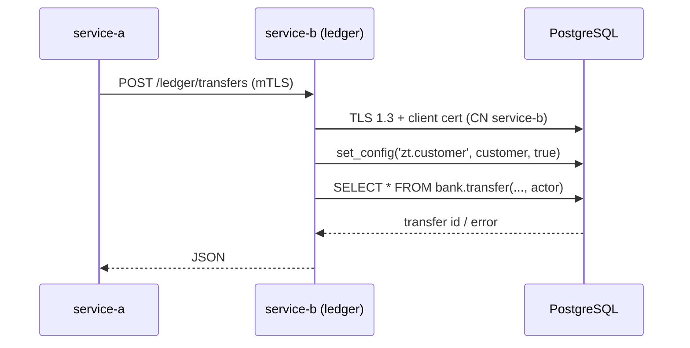

# Service-b (ledger)

## 1. Purpose

Service-b is the only client of the database: it turns ledger requests from service-a into calls to
the database's `bank.*` functions. It exists so that exactly one identity, on one address, can ever
open a database session.

## 2. Responsibilities and non-responsibilities

**Responsibilities**

- accept mTLS connections from service-a only, on the `/ledger/*`, `/health`, `/chain` routes;
- open PostgreSQL sessions with its client certificate (TLS 1.3), as role `service_b`;
- set the customer (`zt.customer`, transaction-local) so row-level security applies, and pass the
  caller's SPIFFE identity to the functions for the audit trail;
- call `bank.transfer()`, `bank.incoming_payment()`, `bank.statements()`, `bank.status()`.

**Non-responsibilities — it must NOT**

- write tables directly (the role cannot: only the functions can);
- accept calls from the frontend or the tunnel;
- hold database passwords (there are none: certificate authentication).

## 3. Where it runs

| Item | Value |
|---|---|
| Host | VM `service-b`, 1024 MB |
| Interfaces | `app0` 10.30.0.12 · `data0` 10.40.0.11 · `mgmt0` 10.50.0.31 |
| Listener | `api-b` 10.30.0.12:9443 (app `ledger`) |
| systemd units | `zt-mtls.service`, `zt-crl.timer`, `zt-cert-renew.timer` |
| Extra package | `python3-psycopg2` (from the cloud host's apt cache) |

## 4. Interfaces

| Direction | Peer | Protocol | Port | Authentication |
|---|---|---|---|---|
| in | service-a (10.30.0.11) | HTTPS, TLS 1.3 | 9443 | client certificate `spiffe://cloud.local/service-a` + source |
| out | database (10.40.0.10) | PostgreSQL over TLS 1.3 | 5432 | client certificate CN `service-b` → role `service_b` (`pg_ident.conf`) |
| out | CA | HTTPS | 9000 | CRL, renewal |
| in | cloud host | SSH | 22 | SSH key, from 10.50.0.1 only |

## 5. Configuration

| Name | Default | Description |
|---|---|---|
| `/etc/zt/mtls.json` | generated (`build/nodes/service-b/mtls.json`) | identity, `api-b` listener, allowed caller, database connection (host, port, user, db) |
| `services.postgres` | `database`, `data`, 5432, `db_user: service_b`, `db_name: appdb` | database target |
| `routes.api-b` | `/ledger/accounts`, `/ledger/accounts/*/entries`, `/ledger/transfers`, `/ledger/statements`, `/ledger/status`, `/ledger/incoming`, `/health`, `/chain` | allowed to `service-a` |

## 6. Internals

The `ledger` handler in [`zt_bank.py`](../ansible/roles/app/files/zt_bank.py) opens a connection with
`sslmode=verify-full`, the internal root and its own certificate ([`zt-mtls`](../ansible/roles/app/files/zt-mtls)),
runs one transaction that sets `zt.customer` with `set_config(…, true)` and calls one database function.



## 7. Security

- **Identity**: `spiffe://cloud.local/service-b` (also CN `service-b` for PostgreSQL), 24 h.
- **Permissions**: `zt-app` user, systemd hardening as the other mTLS services; database role limited
  to `SELECT` under row-level security plus `EXECUTE` on four functions.
- **If compromised**: the attacker can call the bank functions as any customer (the functions still
  enforce ownership, limits, balance and idempotency, and audit every call); it cannot modify or
  delete history (append-only trigger) or read the audit table.

## 8. Operations

```bash
make services
ssh -F build/ssh_config service-b sudo systemctl status zt-mtls --no-pager
ssh -F build/ssh_config service-b "sudo journalctl -u zt-mtls -n 50 --no-pager"
ssh -F build/ssh_config service-b sudo systemctl restart zt-mtls
```

## 9. Failure modes and recovery

| Failure | Symptom | Detection | Recovery |
|---|---|---|---|
| database down or refuses the certificate | 502/500 up the chain | journal; `make test-7` (`test_db_*`) | see [database.md](database.md); `make certs services` |
| certificate expired | database handshake fails | `make test-6` | `make certs` |
| service down | service-a returns 502 | `systemctl status` | systemd restart |

## 10. Tests

| Tests | Command | Expected |
|---|---|---|
| [`tests/unit/test_bank_app.py`](../tests/unit/test_bank_app.py) | `make test-0` | pass (chain to a balanced ledger) |
| [`tests/services/test_services.py`](../tests/services/test_services.py) | `make test-7` | pass: database refuses other identities and plaintext |
| [`tests/bank/`](../tests/bank/) | `make test-10` | pass: RLS, append-only, audit |

## 11. Evidence

- 228 requests from `spiffe://cloud.local/service-a` in 24 h: [evidence/audit.md](evidence/audit.md).

## 12. Limitations

- Single instance; one database connection per request (no pool) — TODO[measure]: transfers per
  second with a load generator from the test peer.

## 13. Related documents

[service-a.md](service-a.md) · [database.md](database.md) · [architecture.md](architecture.md) · [16-zt-bank.md](16-zt-bank.md) (FR)
