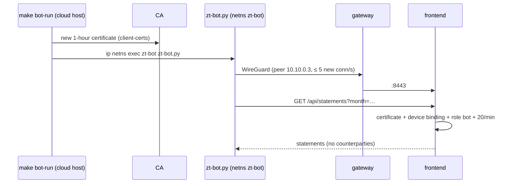

# Statements bot

## 1. Purpose

The statements bot is a non-human actor that downloads monthly account statements through the same
front door as people. It exists to show machine identities under zero trust: its own network namespace,
its own WireGuard peer, a 1-hour certificate bound to that device, and its own rate limit.

## 2. Responsibilities and non-responsibilities

**Responsibilities**

- run in the network namespace `zt-bot` on the cloud host, whose only interface is its WireGuard peer;
- obtain a fresh 1-hour certificate before each run (`make bot-run`);
- call `GET /api/statements?month=YYYY-MM` on the frontend and write the statements to `build/bot/`.

**Non-responsibilities — it must NOT**

- see counterparties or move money (role `bot`: statements, `/api/me`, `/health` only);
- work from any other address: the identity is bound to 10.10.0.3 (`device: bot`);
- open more than 5 new connections per second (gateway `conn_limit`).

## 3. Where it runs

| Item | Value |
|---|---|
| Host | cloud host, network namespace `zt-bot` |
| Address | 10.10.0.3 (WireGuard peer `bot`), routed to the frontend only |
| Program | [`tools/zt-bot.py`](../tools/zt-bot.py); namespace setup by [`tools/zt-test-peer`](../tools/zt-test-peer) |
| Identity | `spiffe://cloud.local/bot/statements`, `cert_lifetime: 1h` |
| Output | `build/bot/` |

## 4. Interfaces

| Direction | Peer | Protocol | Port | Authentication |
|---|---|---|---|---|
| out | gateway | WireGuard / UDP | 51820 | peer key + PSK |
| out | frontend | HTTPS, TLS 1.3 | 8443 | client certificate, device binding (source 10.10.0.3), route role `bot`, 20/min |

## 5. Configuration

| Name | Default | Description |
|---|---|---|
| `actors.statements` in [`policy.yaml`](../policy.yaml) | `role: bot, entry: tunnel, cert_lifetime: 1h, device: bot` | identity, lifetime, device binding |
| `roles.bot.rate_limit` | `20/min` | token bucket at the frontend |
| `wireguard.peers[bot]` | `ip: 10.10.0.3, netns: zt-bot, conn_limit: 5/second` | tunnel peer |
| `build/export/bot/wg0.conf` | generated | the namespace's WireGuard configuration |

## 6. Internals



## 7. Security

- **If its key is stolen**: useless from another address (403, device binding), dead within 1 h, revocable.
- **If the namespace is compromised**: read-only statements, rate-limited, connection-limited.

## 8. Operations

```bash
make bot          # create namespace + WireGuard peer (idempotent)
make bot-run      # fresh certificate + one run; statements in build/bot/
make bot-down     # remove the namespace
sudo ip netns exec zt-bot wg show
```

## 9. Failure modes and recovery

| Failure | Symptom | Detection | Recovery |
|---|---|---|---|
| certificate expired (1 h) | handshake refused | run output | `make bot-run` (always renews first) |
| namespace missing after reboot | `make bot-run` fails | `ip netns list` | `make bot` |
| rate limit | 429 | frontend journal | wait (`Retry-After`) |

## 10. Tests

| Tests | Command | Expected |
|---|---|---|
| [`tests/edge/test_edge.py`](../tests/edge/test_edge.py) | `make test-12` | pass: namespace limited to its tunnel, statements produced, reaches only the frontend, stolen certificate useless elsewhere, rate limits |
| [`tests/unit/test_edge_generated.py`](../tests/unit/test_edge_generated.py) | `make test-0` | pass: peer, device, conn_limit generated |

## 11. Evidence

- 268 requests by `spiffe://cloud.local/bot/statements` in 24 h, and 6 refusals of that identity from
  another address (device binding): [evidence/audit.md](evidence/audit.md).

## 12. Limitations

- Runs on the cloud host (shares its trust) — acceptable for the lab.

## 13. Related documents

[frontend.md](frontend.md) · [gateway.md](gateway.md) · [18-bot-et-partenaire.md](18-bot-et-partenaire.md) (FR)
